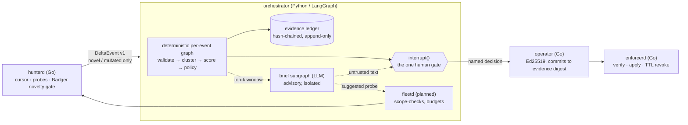
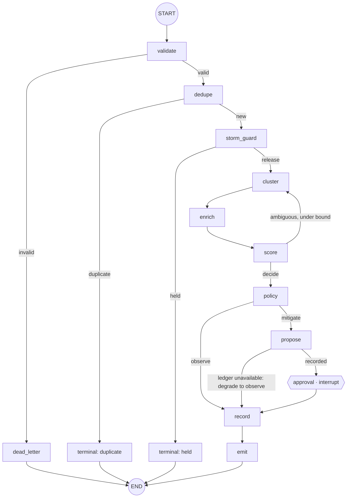

# Agent graph: how LangGraph functions in Sentinel Hunter

**Status:** proposed · **Derived from:** [../spec/ARCHITECTURE.md](../spec/ARCHITECTURE.md), [../spec/DECISIONS/0001-service-boundaries.md](../spec/DECISIONS/0001-service-boundaries.md), [../spec/DECISIONS/0003-architecture-authority.md](../spec/DECISIONS/0003-architecture-authority.md), [../spec/DECISIONS/0004-campaign-belief-ledger.md](../spec/DECISIONS/0004-campaign-belief-ledger.md), [../spec/DECISIONS/0005-mitigation-action-v2.md](../spec/DECISIONS/0005-mitigation-action-v2.md), [../spec/DECISIONS/0007-fleet-command-path.md](../spec/DECISIONS/0007-fleet-command-path.md), the code in `orchestrator/` on `develop`, [fleet/interfaces-and-agent-flow.md](fleet/interfaces-and-agent-flow.md) §5 · **Updated:** 2026-11-21

This is a plan and a contract proposal, not an instruction to build. The authorizing decision it
asks for is `spec/DECISIONS/0008-deterministic-graph-topology.md` (planned); until that ADR is
accepted, §4's topology is a design and §6's tasks are unstarted. Read
[../.agents/outline-method.md](../.agents/outline-method.md) before editing this file.

**Not to be confused with** [../.agents/orchestration/agent-graph.md](../.agents/orchestration/agent-graph.md),
which is design history for the superseded single-binary layout (`HunterState`, `plan_or_reason`,
`execute_safe_tool`, `human_gate`). That design is retired by ADR 0003 and §3 below says so
explicitly, because it is the design a reader is most likely to rebuild by accident.

---

## 1. Goals: what the graph is for in this project

The graph is the **control plane of a defensive system whose headline claim is that review of
consequential action is a technical property, not a prompt instruction**
([../spec/ARCHITECTURE.md](../spec/ARCHITECTURE.md), [../docs/05-safety-and-trust-model.md](../docs/05-safety-and-trust-model.md)).
Everything below follows from that, and from one division of labour: **Go collects and enforces;
Python routes and proposes** ([../.agents/python-langgraph.md](../.agents/python-langgraph.md),
invariant I7).

| # | Goal | Why it is a goal here |
|---|---|---|
| **G-1** | **Turn a stream of novel/mutated observations into at most one reviewable proposal per campaign, with its evidence attached.** | The funnel is steep by design: hundreds of connection attempts a second become a handful of operator decisions an hour ([fleet/interfaces-and-agent-flow.md](fleet/interfaces-and-agent-flow.md) §0, §4). The scarce resource is operator attention, not CPU. |
| **G-2** | **Be deterministic everywhere a decision is made.** Same state plus same `orchestrator/policy.yaml` must give the same `policy`, byte for byte, in any process. | A non-deterministic triage decision cannot be replayed, reviewed, or regression-tested, and an Ed25519 signature over its evidence digest (ADR 0005) would commit to something irreproducible. |
| **G-3** | **Pause, never decide, on anything consequential** — through native `interrupt()` and a durable checkpointer, so a pending approval survives a restart. | Invariant I14 and ADR 0002. A lost pending approval is either an unreviewed action or a dropped defence; both are failures. |
| **G-4** | **Express every outcome as a branch, not an exception.** Invalid event, duplicate, storm, ledger outage, rejection, expiry: each is an edge to a terminal node that records what happened. | Branches are assertable and auditable; a raised exception is a hole in the audit trail and a path with no recorded outcome. |
| **G-5** | **Keep the LLM off every control edge.** A model may summarise and may *suggest a bounded probe*. It may never set `broad`, `kind`, `ttl_seconds`, scope, confidence, or approval. | ml-add rule, fleet §5.2 step 6, ADR 0004 decision 6. The model's input is attacker-influenced text; its output is therefore untrusted data, labelled as such. |
| **G-6** | **Make the graph's shape a reviewable artifact.** The node set, the edge set, and the single interrupt point are declared in a table that a test compares against the compiled graph. | The repository's own failure mode has been drift between documents and code (ADR 0003). A topology that only exists in `orchestrator/graph.py` drifts; a topology a test pins does not. |
| **G-7** | **Process each event exactly once, durably, under backpressure** — ack only after its outcome is durable, resume redeliveries on the same thread. | At-least-once transport plus idempotent threads is the only combination that loses nothing and doubles nothing (fleet §5.1 step 14, E28). |
| **G-8** | **Stay cheap to reason about.** One flat per-event graph, one separate brief graph, nodes under one responsibility each, wiring readable in one screen. | [../.agents/python-langgraph.md](../.agents/python-langgraph.md) module layout. A topology nobody can hold in their head is a topology nobody reviews. |

**Non-goal:** throughput. One process already handles two orders of magnitude more than steady load
(fleet §4.2). Effort spent on scaling Python is effort not spent on the operator queue.

---

## 2. Where the graph sits



The graph owns no capability. It cannot dial a target, sign an action, install a rule, or widen a
scope. Its only outputs are: a ledger record, an interrupt payload, and a suggestion that another
service is free to refuse.

---

## 3. Formally retired, so nobody rebuilds it

| Retired | Replaced by | Authority |
|---|---|---|
| `HunterState` with `pending_events`, `human_decision`, `iteration_count` | `GraphState` in `orchestrator/state.py` | ADR 0003 |
| `plan_or_reason`: an LLM choosing the next tool call each iteration | A deterministic pipeline; the LLM is advisory only (G-5) | ADR 0003, ADR 0004 decision 6 |
| `execute_safe_tool` / tier-gated tool execution inside the graph | Probing moves behind `fleetd` (planned) MCP, which scope-checks and budgets every request | ADR 0007 |
| `mission.yaml` as the autonomy surface | `orchestrator/policy.yaml` keys for policy; a signed scope bundle for scope | ADR 0003 consequence 3, ADR 0007 decision 5 |
| Python enforcing tier bounds | Go enforces; Python mirrors bounds for routing and presentation only | Invariant I7 |

The one idea worth keeping from the retired design is its instinct: **the interesting part of the
system is the pause.** This plan keeps that and removes the agent loop around it.

---

## 4. The contract this plan asks ADR 0008 to accept

### 4.1 Determinism rules (D-rules)

Numbered so tests and reviews can cite them, the way they cite invariants.

- **D1 — One interrupt node.** Exactly one node in the whole system calls `interrupt()`. A second
  pause point is a second place a hostile input can try to route around the first.
- **D2 — Routers are pure, total, and mapped.** A router is a function of `GraphState` plus loaded
  policy, returns a key of an explicit destination map, performs no I/O, and has a destination for
  every input.
- **D3 — Decision nodes are pure.** `cluster`, `score`, `policy` read state and policy and nothing
  else. No clock, no randomness, no network, no filesystem beyond the SHA-256-pinned artifacts
  `orchestrator/provenance.py` already verifies.
- **D4 — Time and identity are injected.** A node that needs *now* or a new id takes a `clock` or
  `new_id` through its factory. `datetime.now`, `uuid4`, and `random` do not appear in a node body.
- **D5 — No mutation.** A node returns only the keys it changed, as new objects. Mutating a value
  read from state aliases checkpoint history.
- **D6 — Failure is a branch.** Every failure mode routes to a terminal node that records it.
  Nothing raises past its own frame, and nothing is swallowed.
- **D7 — The threshold file is bound into the record.** Every ledger record carries
  `policy_sha256`, so a decision is reproducible against the exact thresholds that produced it.
  (Already implemented in `orchestrator/ledger.py`.)
- **D8 — One thread per unit of work, namespaced.** `event:<event_id>` for triage,
  `campaign:<cluster_id>` for a coalesced approval, `brief:<window_start>` for a brief. A thread is
  never shared between unrelated units; a resume on a foreign thread delivers nothing.
- **D9 — Ack after durability.** A transport message is acked only once its ledger record or its
  interrupt checkpoint has committed.
- **D10 — The model writes to a quarantined key.** Brief output lands in a state key no policy node
  reads, and a test asserts the policy output is byte-identical with the brief on, off, or
  adversarial.

### 4.2 Target topology

Today (implemented, `orchestrator/graph.py`): `START → cluster → intel → {cluster | mitigate} →
[propose] → approval → [record] → END`. Four to six nodes, one cycle, one interrupt.

Target: the same spine with the boundary work lifted out of exception handlers and into branches.



| Node | Module | Class | Writes | State |
|---|---|---|---|---|
| `validate` | `orchestrator/ingest.py` (planned) | pure | `event`, `reject` | planned |
| `dedupe` | `orchestrator/dedupe.py` (planned) | bounded store | `duplicate` | planned, needs `content_sha256` from [fleet/README.md](fleet/README.md) phase 2 |
| `storm_guard` | `orchestrator/storm.py` (planned) | bounded store | `held` | planned |
| `cluster` | `orchestrator/cluster.py` | pure | `cluster`, `cycles` | implemented |
| `enrich` | `orchestrator/enrich.py` (planned) | pure over pinned data | `enrichment` | planned; ASN source is an open question |
| `score` | `orchestrator/score.py` | pure | `intel` | implemented |
| `policy` | `orchestrator/policy.py` | pure | `policy` | implemented |
| `propose` | `orchestrator/ledger.py` | append-only, bounded retry | `proposal`, may degrade `policy` | implemented |
| `approval` | `orchestrator/policy.py` | **interrupt (D1)** | `policy` | implemented |
| `record` | `orchestrator/ledger.py` | append-only | — | implemented |
| `emit` | `orchestrator/emit.py` (planned) | adapter | `handoff` | planned |

| Router | After | Destinations | Decides on |
|---|---|---|---|
| `route_after_validate` | `validate` | `dedupe`, `dead_letter` | Pydantic result, `extra="forbid"` |
| `route_after_dedupe` | `dedupe` | `storm_guard`, terminal | content hash seen inside the dedupe window |
| `route_after_storm` | `storm_guard` | `cluster`, terminal | `rebaseline`, or source rate above the storm factor |
| `route_after_intel` | `score` | `cluster`, `policy` | confidence window and the cycle bound — **removed by G5** |
| `route_after_policy` | `policy` | `propose`, `record` | `action == "mitigate"` |
| `route_after_proposal` | `propose` | `approval`, `record` | a proposal record exists and the action is unapproved |

### 4.3 What the interrupt payload must carry

The payload is the operator's entire decision surface, so it is a contract, not a convenience. Today
it carries `type`, `action_id`, `target`, `broad`, `confidence`, `max_ttl_seconds`, and — when a
ledger is wired — `ledger_seq` and `evidence_digest` (ADR 0005). This plan adds, in G7 and G6, the
coalesced event count and the brief, the latter labelled as model text. It is JSON-serializable and
holds no secrets, and the resume values stay `approve` / `edit` / `reject` as
[../.agents/python-langgraph.md](../.agents/python-langgraph.md) tabulates them, with **missing or
malformed meaning reject**.

---

## 5. Where the LLM is allowed, and the firewall around it

One place: a **brief subgraph** over the top-k clusters of a time window
([fleet/README.md](fleet/README.md) phase 8, [fleet/interfaces-and-agent-flow.md](fleet/interfaces-and-agent-flow.md) §5.2).
Its rules are D5, D10 and:

1. Separate compiled graph, separate thread namespace, no state key shared with the per-event graph
   except by explicit copy into the quarantined key.
2. Input is an allowlist of fields. Attacker-controlled text (titles, SANs) is truncated, escaped,
   and wrapped as data, never placed in instructions.
3. `stop_reason` of `refusal` or `max_tokens` means **no brief**: never parsed, never retried with a
   looser prompt.
4. Output is used in three places only — attached to a pending approval and labelled untrusted, the
   ledger, and bounded suggestions to `fleetd` (planned) which scope-checks and budgets them.
5. Budgets and models come from policy keys and [../.agents/orchestration/models.md](../.agents/orchestration/models.md);
   tests never call a live model.

If the brief cannot be built this way, the correct outcome is no brief. The deterministic path is
the product; the brief is an aid to the human reading it.

---

## 6. Tasks

Conventions follow [PHASESv1.0.md](PHASESv1.0.md) §4: parent tasks state owner, dependencies,
parallel-safety and a model-tier hint from [../.agents/evals/constitution.md](../.agents/evals/constitution.md);
child tasks are checkboxes closed **with evidence**:

```
- [x] G1.4 <description> — done YYYY-MM-DD, commit <short-sha>, evidence: <command run>
```

A box flipped with no evidence suffix is not done. `🔒 HUMAN CHECKPOINT` lines are never closed by
an agent. Tests come first in every task ([../.agents/testing.md](../.agents/testing.md)).

**Scope boundary.** This document owns the *graph contract* and the graph-shaped work. Where a task
needs transport, the implementation detail stays in the plan that owns it, cited rather than copied:
[fleet/README.md](fleet/README.md) phases 2, 4, 6, 8, 9 and [ml-add/README.md](ml-add/README.md).
No task here touches `hunterd/`, `operator/`, `enforcerd/` or any branch listed in
[../.agents/orchestration/obs/state-log.md](../.agents/orchestration/obs/state-log.md); the Go-side
SHR repairs are held by other worktrees.

### G0 — Lock the graph contract
Owner: `spec/`, `orchestrator/tests/` · Depends on: nothing · Parallel-safe: yes · Tier: Opus (architecture and invariant surface)

- [ ] G0.1 Write `spec/DECISIONS/0008-deterministic-graph-topology.md` (planned): the D-rules, the node and edge tables, the thread scheme, ack ordering, and the LLM firewall. Numbering note: 0006 is reserved by [graph-store/Phase-0.md](graph-store/Phase-0.md).
- [ ] G0.2 Register every `GraphState` key in [../spec/STATE.md](../spec/STATE.md): writing node, readers, and whether a policy node may read it. Resolve `Policy.kind` admitting `headscale` with no backend behind it — narrow the type or record the exception with its ADR.
- [ ] G0.3 `orchestrator/tests/test_topology.py` (planned): the compiled graph's node set and edge set equal the declared table. Adding a node or an edge fails until the table and the ADR move with it.
- [ ] G0.4 Router totality tests: each router returns only keys of its destination map, over its whole input domain including absent and hostile values (D2).
- [ ] G0.5 Assert D1 mechanically: exactly one node reachable from `START` calls `interrupt()`.
- [ ] 🔒 HUMAN CHECKPOINT: owner accepts ADR 0008. Until then §4 is a design, and G1 to G8 do not start.

### G1 — Determinism harness
Owner: `orchestrator/` · Depends on: G0.1 · Parallel-safe: yes · Tier: Sonnet, Opus for the eval design

- [ ] G1.1 Inject `clock` and `new_id` through node factories; remove any direct clock or randomness from node bodies (D4).
- [ ] G1.2 A test — not a convention — that fails when a node module references `datetime.now`, `uuid4`, `random`, or a module-level client (the red-flag table in [../.agents/python-langgraph.md](../.agents/python-langgraph.md)).
- [ ] G1.3 Golden corpus: extend `orchestrator/tests/fixtures/triage/scenarios.jsonl` with a golden `policy` per scenario, replayed through `orchestrator/eval/replay.py`.
- [ ] G1.4 **E33 determinism replay** (new, hard): the corpus replayed twice in one process and once in a fresh process yields identical `policy` dicts and identical record body hashes, modulo `seq` and the chain's previous hash.
- [ ] G1.5 Assert `policy_sha256` is present and correct in every record, and that changing a threshold changes it (D7).

### G2 — Durable interrupt, closing the oldest open checkpoint
Owner: `orchestrator/graph.py` · Depends on: G0.1 · Parallel-safe: yes · Tier: Sonnet, escalate on resume semantics

Closes [planv1.0/PHASE2.md](planv1.0/PHASE2.md) P2.2 and HC-4 in [fleet/README.md](fleet/README.md).

- [ ] G2.1 Select the checkpointer from configuration in `orchestrator/config.py` (planned), not from `orchestrator/policy.yaml` — that file holds risk thresholds, and a storage backend is not one.
- [ ] G2.2 Fail closed: a non-test entrypoint refuses to start with `checkpointer=None` or an in-memory saver.
- [ ] G2.3 Thread-id convention module plus a test that a resume on a foreign thread id delivers nothing and changes nothing (D8).
- [ ] G2.4 Validate the resume payload at the boundary: a missing `approved` is reject, and a non-numeric `ttl_seconds` is rejected rather than raising mid-node. This closes the open error-log row on `int(decision["ttl_seconds"])`. Table-test missing, below minimum, at minimum, at maximum, above maximum, wrong type, hostile string.
- [ ] G2.5 Extend `orchestrator/tests/test_checkpointer_restart.py` to the coalesced and degraded paths once G7 and G3 land.
- [ ] 🔒 HUMAN CHECKPOINT (HC-4): the backend choice, SQLite or Postgres, against the deployment plan. An infrastructure decision, not an engineering one.

### G3 — Boundary branches instead of exception handlers
Owner: `orchestrator/` · Depends on: G0.3 · Parallel-safe: partly (G3.3 waits on fleet phase 2) · Tier: Sonnet

- [ ] G3.1 `validate` node and the `dead_letter` branch: an event failing `extra="forbid"` is recorded and counted, and never reaches `cluster`.
- [ ] G3.2 `storm_guard` node, the `held` terminal, and the release path; a parked event is never briefed and never interrupts.
- [ ] G3.3 `dedupe` node on `content_sha256` with a bounded store. Blocked until [fleet/README.md](fleet/README.md) phase 2 emits a time-free content hash — the fingerprint defect SHR-016 would otherwise make every repeat observation look mutated.
- [ ] G3.4 **E35 branch totality** (new, hard): for every failure mode, the run reaches `END` through a declared branch with a recorded outcome; no node raises past its own frame; a ledger outage degrades a proposal to `observe` (already implemented — assert it).

### G4 — Ingest and ack ordering
Owner: `orchestrator/ingest.py` (planned) · Depends on: G2, G3.1 · Parallel-safe: no · Tier: Sonnet

Transport detail belongs to [fleet/README.md](fleet/README.md) phase 6; the graph-side contract is here.

- [ ] G4.1 One graph thread per event, keyed `event:<event_id>`, so a redelivery resumes the checkpoint instead of running twice (D8).
- [ ] G4.2 Ack only after the ledger record or the interrupt checkpoint commits (D9); test a crash between the two.
- [ ] G4.3 Poison message to a dead letter after the delivery bound, recorded, never silently dropped.

### G5 — Retire the refinement cycle (SHR-014)
Owner: `orchestrator/score.py`, `orchestrator/cluster.py` · Depends on: G1.3 · Parallel-safe: yes · Tier: Sonnet

The ADR 0004 addendum already decided the loop goes; G1's corpus is what makes the removal provable
rather than asserted.

- [ ] G5.1 Prove the no-op on the corpus: replay with the cycle bound at its minimum and above it, and show identical policy output.
- [ ] G5.2 Remove the loop, the `cycles` state key and the `max_refinement_cycles` key; decide `AMBIGUOUS_FLOOR` — a policy key or gone with the loop. This answers the "ambiguity floor" open question in [../.agents/orchestration/obs/state-log.md](../.agents/orchestration/obs/state-log.md).
- [ ] G5.3 Assert the per-event graph is acyclic in `orchestrator/tests/test_topology.py` (planned), and record the closure in [../spec/STATE.md](../spec/STATE.md).

### G6 — Analyst brief subgraph, isolated
Owner: `orchestrator/brief.py` (planned) · Depends on: G0, G1, fleet phases 5 and 6 · Parallel-safe: yes · Tier: Opus for the isolation tests, Sonnet for the adapter

- [ ] G6.1 A separate compiled graph with its own thread namespace; no state key shared with the per-event graph except the quarantined brief key (D10).
- [ ] G6.2 Field allowlist, truncation and escaping of attacker-controlled text, and the data-not-instructions wrapping.
- [ ] G6.3 Refusal and truncation handling: `refusal` or `max_tokens` means no brief, recorded, never retried looser.
- [ ] G6.4 Budget and circuit-breaker behaviour against a mocked client; no test calls a live model.
- [ ] G6.5 Eval E27 brief isolation (existing, hard): policy output byte-identical with the brief on, off, and replaced by adversarial text.
- [ ] 🔒 HUMAN CHECKPOINT (HC-5): data handling for sanitised evidence sent to the API, the field allowlist, and the daily budget.

### G7 — Approval queue: coalescing, expiry, labels
Owner: `orchestrator/approvals.py` (planned) · Depends on: G2, G4 · Parallel-safe: yes · Tier: Sonnet

- [ ] G7.1 One pending approval per campaign, threaded `campaign:<cluster_id>`, carrying the event count rather than one interrupt per event.
- [ ] G7.2 Expiry: an unreviewed proposal past its TTL is recorded as an outcome, not silently dropped.
- [ ] G7.3 A cap on pending approvals; above it the system alerts and keeps queueing. It never auto-approves and never raises the narrow-auto-approval switch.
- [ ] G7.4 Outcome labels (approve, reject, late label) appended to the ledger and linked to the decision's record hash, per [fleet/README.md](fleet/README.md) phase 9 and ADR 0005.

### G8 — The one-way boundary to the operator
Owner: `orchestrator/emit.py` (planned) · Depends on: G0 · Parallel-safe: yes · Tier: Opus (trust boundary)

- [ ] G8.1 `emit` node produces the approval-request artifact and nothing else; a test asserts no signing primitive is reachable from `orchestrator/`.
- [ ] G8.2 **E34 graph boundary** (new, hard): no sequence of events, attribute values, resume payloads or brief text makes the graph produce a signature, widen a scope, raise a TTL past the ceiling, mark a broad action approved without a decision, or reach an enforcement backend.
- [ ] G8.3 Interrupt payload completeness test: every field §4.3 lists is present for a broad action, and no secret or raw target list is.
- [ ] G8.4 **E36 thread isolation** (new, hard): decisions never cross threads; a resume on the wrong thread is inert; a stale `proposal` from an earlier run on the same thread can never be cited by a later record (the regression already fixed on `develop` — pin it).

---

## 7. New evals

Added to [../.agents/evals/evals.md](../.agents/evals/evals.md). E01 to E32 are allocated (E11 to
E13 and E17 to E20 to the campaign belief ledger, E14 to E16 to the CLI, E21 to E32 to the fleet
plan), so this plan takes E33 to E36.

| ID | Name | Pass condition | Gate | Task |
|---|---|---|---|---|
| E33 | Determinism replay | Identical policy output and record body hashes across runs and processes | Hard | G1.4 |
| E34 | Graph boundary | No path signs, widens scope, raises a TTL past the ceiling, or reaches a backend | Hard | G8.2 |
| E35 | Branch totality | Every failure mode reaches a declared terminal with a recorded outcome | Hard | G3.4 |
| E36 | Thread isolation | No decision crosses a thread; a foreign resume is inert | Hard | G8.4 |

E05 (prompt injection) and E06 (tier routing) are retargeted onto this topology by ADR 0003 and
remain a hard and an ordinary gate respectively. Neither has run; neither may be reported as
passing.

---

## 8. Configuration this plan touches

No new risk threshold is introduced here. Keys this plan *reads* are cited by name only, per
[../.agents/outline-method.md](../.agents/outline-method.md) §5: `policy.yaml: mitigation_confidence`,
`broad_prefix_threshold`, `broad_prefix_threshold_v6`, `auto_approve_narrow`, `default_ttl_seconds`,
`min_approved_ttl_seconds`, `max_approved_ttl_seconds`, `ledger_append_attempts`, and —
until G5 removes it — `max_refinement_cycles`.

Keys G3, G6 and G7 depend on (`dedupe_window_hours`, `storm_factor`, `top_k`,
`brief_window_seconds`, `brief_model`, `llm_daily_usd`, `suggest_quota_per_hour`,
`proposal_ttl_seconds`, `max_pending_approvals`) are introduced by the fleet phases that own them,
not duplicated here. The checkpointer backend is infrastructure configuration, not policy (G2.1).

---

## 9. Sequencing

| Order | Work | Blocked by |
|---|---|---|
| 1 | G0, G1, G8 | nothing — all three are contract and test work on implemented code |
| 2 | G2, G5 | G0.1 accepted; G5 also needs G1.3's corpus |
| 3 | G3.1, G3.2, G3.4 | G0.3 |
| 4 | G3.3 | fleet phase 2 (time-free content hash) |
| 5 | G4, G7 | G2; fleet phase 4 for transport |
| 6 | G6 | fleet phases 5 and 6, and HC-5 |

G0, G1, G2, G5 and G8 are the whole of the near-term work and none of them is blocked by anything
outside `orchestrator/`. They are also the tasks that make every later one verifiable, which is why
they come first.

**What this plan does not unblock.** Nothing here closes the scope gate (invariants I1 to I5,
SHR-011), which ADR 0003 consequence 4 records as the highest-priority outstanding work in the
repository. No task here justifies active probing outside `lab/`, and the graph's suggestion path
(G6) stays dark until a signed scope bundle exists.

---

## 10. Open questions

- **Ambiguity floor.** Policy key or deleted with the loop (G5.2)? The state log has carried this
  question since 2026-11-21.
- **Enrichment sources.** The ASN database and the CDN data set, both of which must be pinned and
  offline to satisfy D3. Open in the state log.
- **Dedupe and held-event durability.** Both tables are rebuildable from the ledger, which argues
  for keeping them small and disposable; the fleet plan assumes a bounded store. Which store, and
  does it survive a restart or rebuild from the ledger?
- **Brief as a second injection surface.** G6 adds a model that reads attacker-influenced text.
  D10 and E27 bound its *influence*; they do not bound its *cost* if an adversary can inflate the
  window. G6.4's budget is the control; whether that is sufficient is for HC-5 to judge.
- **One graph or subgraphs?** This plan chooses one flat per-event graph plus a separate brief
  graph, because a flat topology is assertable in a single table (G-6). If the node count passes
  roughly a dozen, revisit with an ADR rather than nesting quietly.

---

## 11. Naming: the directory, and why it keeps the one it has

### 11.1 The better name, recorded and not taken

The accurate name for this package is `triage`, with a `triaged` process name once G4 makes it a
long-running consumer. Every piece of prose in the repository already calls it that —
`orchestrator/tests/fixtures/triage/`, `orchestrator/tests/test_triage_quality.py`, eval E07
"Triage quality", [PHASESv1.0.md](PHASESv1.0.md) "Triage Core", and `orchestrator/CLAUDE.md`'s own
purpose line — and it would name a role beside `hunterd` (finds), `operator` (approves) and
`enforcerd` (acts, expires) rather than implying, as "orchestrator" does, that this package drives
other services. It drives nothing: §2. The thing that commands hunters is `fleetd` (planned).

It is nonetheless **not being renamed**, because the repository's own gate says not to. Scored with
the `refactor-eval` skill, counted from the proposed diff rather than the intention:

| Candidate | `L` | `B` | `I` | `U` | `A` | `N` | `S` | Flag | Verdict |
|---|---|---|---|---|---|---|---|---|---|
| rename `orchestrator` to `triage` | 0 | 0 | 0 | 0 | 0 | 0 | 0 | Critical | reject |
| extract `orchestrator/routers.py` (planned) from existing modules | 0 | 0 | 0 | 0 | 0 | 1 | −20 | High | reject |
| move evidence and scorer modules into subpackages | 0 | 0 | 0 | 0 | 0 | 4 | −80 | High | reject |

A rename removes no branches, no indirections and no duplicate blocks, so it scores in the reject
band, and the skill is explicit that nothing is counted for making future work easier. The flag is
Critical because the move carries the files that hold the `GraphState` contract and the threshold
source. The row is in [../.claude/skills/refactor-eval/scorecard.md](../.claude/skills/refactor-eval/scorecard.md)
so it is not re-proposed. If the name is ever taken, the only sane moment is as its own commit,
under its own ADR, **before** G3 and G6 add modules — renaming eleven files is cheaper than
renaming nineteen — and it needs explicit per-row permission, not an inference from this paragraph.

### 11.2 What was renamed instead

The collision was never really the directory; it was that one word named two things, and the
dispatch surface had three agents for two roles. Resolved at the documentation layer, where it costs
nothing: `.agents/evals/phase-runner.md` (was `orchestrator.md`) is the build loop, and
`.claude/agents/phase-runner.md` (was `master-orchestrator.md`) is the agent that runs it.
`conductor` keeps its name as the analyse-and-propose half. **`orchestrator` now means exactly one
thing: the Python package this document plans.** No agent description needs a disclaimer to say
which orchestrator it means.

### 11.3 Where the naming decision is still free

The eight modules §4.2 and §6 add do not exist yet, so their names and placement cost nothing now
and are permanent later. They stay **flat**, as siblings — the idiom
[../.agents/python-langgraph.md](../.agents/python-langgraph.md) states, and the only shape that
`refactor-eval` does not charge 20 a unit for. Structure is enforced by an import-direction test,
not by directories:

- Nothing imports `orchestrator/brief.py` (planned); it imports nothing from `score.py` or
  `policy.py` (D10).
- Only `orchestrator/adapters.py` (planned) performs I/O — clock, ids, the fleet client (D3, D4).
- `orchestrator/routers.py` (planned) holds every conditional-edge function, for the same reason
  `graph.py` is wiring-only: the whole branch set should read in one screen (D2). It is new code
  there, not a move, so §11.1's rejection does not apply to it.
- `orchestrator/config.py` (planned) holds the checkpointer backend and the thread-id scheme.
  Infrastructure is not risk policy and does not belong in `orchestrator/policy.yaml` (G2.1).

That test is worth more than any folder layout, and it is already G1.2 and G8.1.
