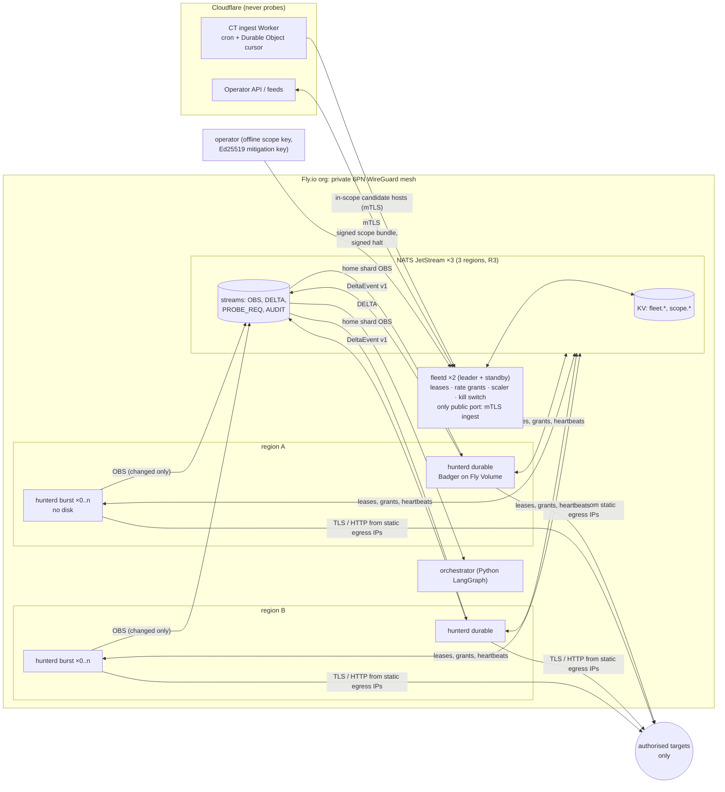
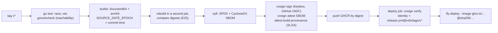
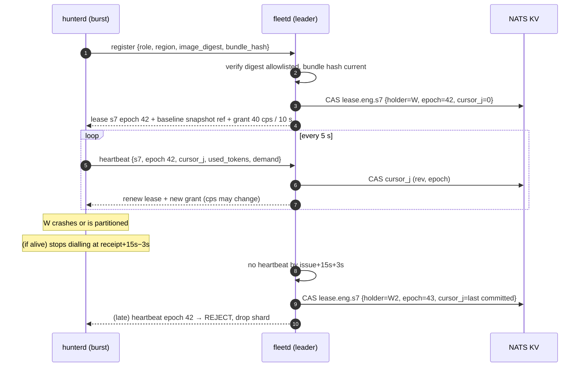
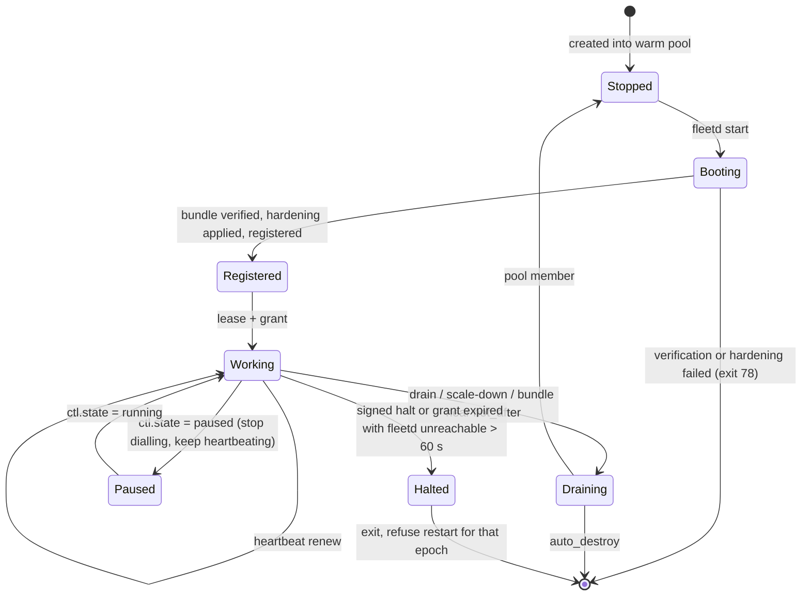

# Hunter Fleet: build, footprint and scale-out design

**Status:** proposed (design only, nothing implemented) · **Date:** 2026-11-20 · **Repo baseline:** `sensai-0x0/cyber-oss` @ `25b9898` (`develop` merge of ML review phasing)
**Applies to:** `hunterd/` and a new `fleetd/` control service · **Needs:** ADR 0007 and contract-steward review before any code

Every claim carries one of three tags:

| Tag | Meaning |
|---|---|
| **[M]** | Measured in this session against the repo at `25b9898` (commands in Appendix A) |
| **[R]** | Read directly from the repo or the context pack |
| **[U]** | Unverified. A vendor fact, an estimate or a design assumption. Each one has a check in §19 |

---

## 0. Summary (read this if nothing else)

1. **One image, three roles.** A single static Go binary built `FROM scratch` runs as a `durable` node (owns Badger), a `burst` worker (no disk, ephemeral) or `selftest`. A separate small `fleetd` binary is the only authority for shard leases, rate grants and the kill switch. Today's image would be about **45 MB uncompressed, about 16 MB compressed [M]**. A lean prober track gets that to about **12 MB / 5 MB** (the Go stdlib TLS, HTTP and Badger core measures 10.2 MB / 4.1 MB [M]).
2. **Shard by /24 block ownership, not by address.** A two-level Feistel walk gives each lease whole /24 blocks. Every per-target and per-/24 limit is then enforced **locally by exactly one worker**, with no network round trip. Only the engagement-wide budget needs coordination.
3. **Rate is conserved, not scaled.** `fleetd` hands out time-boxed rate grants whose sum never exceeds the signed global budget. A grant that is not renewed decays to zero, so a partition, crash or zombie stops dialling by itself. Adding machines adds compute, never rate.
4. **Leases and grants use relative durations only.** A worker stops at `receipt + TTL − margin`. `fleetd` reclaims at `issue + TTL + margin`. Correctness needs sane clock *rates*, not synchronised clocks. A new `fleetd` leader waits one full TTL before it issues anything.
5. **Scope is a signed bundle, checked three times.** It is an Ed25519-signed, short-lived scope bundle whose public key is compiled into the binary. It is enforced (L1) in Go before enqueue, (L2) in the dialer's `Control` hook on the real socket address, and (L3) by an in-VM nftables egress allowlist installed before privileges drop. A compromised control plane cannot widen scope.
6. **Hardening is in-process, because Fly Machines are microVMs, not containers.** Docker flags such as `--read-only`, `--cap-drop` and seccomp profiles do not apply on Fly [U]. The binary hardens itself at boot: nftables, then drop to uid 65532, `no_new_privs`, Landlock (read-only except `/data`) and a seccomp allowlist that **denies `execve`** and raw sockets. There is no shell in the image.
7. **Fail closed everywhere.** No fresh lease, no fresh grant, an expired bundle or a pause key set all mean that no packet is sent. The kill switch has four levels, from a 1 s soft pause to infrastructure stop (§14).
8. **Hosting: container images on Fly.io Machines, with no long-lived VMs to manage.** Each hunter is the same OCI image, launched through the Machines API in about a second [U: B3], billed per second, stopped or destroyed when idle. Burst workers are disposable. Even the "durable" role is just the same image on a Machine with a volume attached, and it can be stopped between passes. Google Cloud Run Jobs is the portability target for burst work (§17.4).
9. **Blockers before any non-lab deployment:** the scope package itself (ADR 0003 consequence 4, still absent [R]), Fly's AUP on scanning [U], and benchmarks B1 to B4 (§19).

Two findings in today's code need fixing whatever happens with the fleet (§2): Badger runs on `DefaultOptions` (peak about **720 MB RSS** in a write test [M]), and `cursor.NewRange` on a `/32` **panics** [M].

---

## 1. Goals and non-goals

**Goals.** Small, signed and reproducible images. Cheap idle cost with scale-to-zero. Scale-out for high-traffic periods (CT bursts, large authorised ranges, multi-vantage re-probes) without ever exceeding per-target, per-/24 or engagement-wide limits. Scope enforced on every worker even if the control plane is compromised. Hardened runtime. Clear health, kill switch and failure behaviour.

**Non-goals.** Probing from Cloudflare Workers (their terms forbid scanning, and Workers have no raw TLS control [R, chat decision]). IPv6 targets (`cursor.NewRange` is IPv4-only [R]). Intrusive scanning. Any Nuclei template beyond a pinned passive allowlist.

---

## 2. Ground truth: what the repo has today

| Area | Today [R] | Consequence for this design |
|---|---|---|
| Process model | `hunterd serve`: gRPC health on `127.0.0.1:50051`, NDJSON events on stdin/stdout, bounded queue (`-event-capacity 256`) | Keep the bounded queue. Replace the stdio transport with a JetStream publisher in fleet mode, and keep NDJSON for the lab and tests |
| MCP | ADR 0003: `hunterd` is "not an MCP server, by decision" | **Decided (ADR 0007):** commands go over NATS as signed envelopes from `fleetd`. If the agent needs MCP, it is served by `fleetd` (streamable HTTP, private), never by workers. See §18.3 |
| Scope | **Not implemented.** `tls_runner.go` calls `service.Connect` directly; `http_runner.go` passes `target` straight to httpx | §9 is the fix, and it is phase F0. Nothing in this design may probe before it lands |
| Feistel | `cursor.Permute` (4-round, HMAC-SHA256 round function), `Range{next,count}` with O(1) memory | Reused as is for both levels of §6. **Bug [M]:** `NewRange("x.x.x.x/32")` then `Next()` panics (`Permute(0, 0, key)` rejects `bits == 0`). A library panic also breaks the Go idioms. Fix: special-case `hostBits == 0` |
| Badger | `badger.Open(badger.DefaultOptions(path))`, stores the **full payload** per observation | **OOM risk on small VMs [M]** (§16.3). Tune the options and store hash plus compact attributes, not the payload |
| Delta gate | One Badger `Update` transaction, TTL per observation key | Unchanged. Single writer per directory (I17) is kept by giving each shard one *home* durable node (§10) |
| Transport | `deploy/nats/nats.conf`: JetStream, TLS, one shared user/password, lab only | Production needs per-worker NATS credentials with subject permissions (§10.3) |
| Module path | `github.com/metacogna/sentinel-hunter`, but the repo is `sensai-0x0/cyber-oss` | Cosmetic, but the cosign identity and image name should follow the repo. Decide one |

---

## 3. Topology



Rules this picture encodes:

- Hunters have **no public services and no public IPs** (`fly ips list` must be empty for the hunter apps; CI asserts it). Their only listeners are health and metrics, reachable over 6PN.
- Workers take commands only from NATS subjects that only `fleetd` may publish to (§10.3), and they verify scope themselves (§9). `fleetd` is trusted for *liveness* (it can stop work) but not for *scope* (it cannot widen it).
- The orchestrator consumes `DeltaEvent v1` unchanged. The new `vantage` and `shard` attributes are additive, and v1 consumers tolerate unknown attributes [R, `spec/STATE.md`].

---

## 4. Roles

| Role | Binary / mode | State | Lifetime | Count | Owns |
|---|---|---|---|---|---|
| **durable** | `hunterd serve --mode=durable` | Badger on a Fly Volume at `/data` | Long-lived; may be stopped between passes | 1 per region (min 1, usually 2 to 3 regions) | Delta gate for its *home* shards; baseline snapshots; local outbox |
| **burst** | `hunterd serve --mode=burst` | None. Read-only filesystem, nothing writable | Minutes to hours; warm pool of stopped machines; auto-destroy | 0..N per region | Nothing durable. Holds leases and grants only while alive |
| **fleetd** | `fleetd` (new service, ADR 0007) | NATS KV only | Long-lived | 2 (leader + standby in different regions) | Lease table, rate grants, autoscaler, kill switch, scope bundle distribution, CT ingest endpoint |
| **selftest** | `hunterd selftest` | None | One-shot | n/a | Prints kernel features (nf_tables, Landlock ABI, seccomp), rlimits, CPU and memory; used by B4 |

Why one image for durable and burst: one SBOM, one signature, one vulnerability surface and one benchmark. Badger is only about 2 to 3 MB of the binary (core build below), so a `nobadger` build tag is not worth a second artefact.

Why `fleetd` is separate from `hunterd`: it needs the Fly Machines API token and a public mTLS port, and hunters must have neither. Keeping it apart keeps the hunter's egress allowlist free of `api.machines.dev` and the public internet.

---

## 5. Image construction

### 5.1 Measurements [M]

| Build | Size | gzip -9 (≈ layer size) |
|---|---|---|
| `go build` default, amd64 | 58.4 MB | n/a |
| `-trimpath -ldflags="-s -w -buildid="`, amd64 | **45.3 MB** | **16.0 MB** |
| same, arm64 (cross-compiled, no QEMU) | 43.4 MB | n/a |
| tlsx runner + Badger only | 45.7 MB | n/a |
| Go stdlib `crypto/tls` + `net/http` + Badger + Feistel ("core") | **10.2 MB** | **4.1 MB** |
| Two clean amd64 builds of the same commit | **byte-identical** (`333d36e9…`) | n/a |
| Idle RSS of `hunterd serve` | **52 MB** | n/a |

What the measurements say:

- **tlsx is the footprint, not httpx.** tlsx plus Badger alone is the same size as the full binary, because httpx shares tlsx's dependency tree. The binary embeds 143 modules (`go version -m`), including `go-rod` (headless Chrome driver), `goja` (JavaScript engine), `go-exploit`, `go-openai` and `gofakeit`. None of these are needed to read a certificate. They are size, and they are attack surface: go-rod can download and exec a browser, which is one reason the seccomp policy denies `execve` (§12).
- **Reproducibility already holds** at the binary level with `-trimpath -buildid=`. The image layer also needs `SOURCE_DATE_EPOCH` and BuildKit's `rewrite-timestamp=true` [U: BuildKit ≥ 0.13], or `ko`, which is reproducible by construction.

### 5.2 Size targets

| Track | Uncompressed | Compressed | Gate |
|---|---|---|---|
| v1 (tlsx + httpx as libraries) | ≤ 50 MB | ≤ 18 MB | CI fails above target |
| v2 "lean prober" (stdlib TLS + small JARM + `net/http`) | ≤ 15 MB | ≤ 6 MB | Behind feature parity tests against v1 on the lab |
| `hunterd-nuclei` optional variant (build tag `nuclei`) | measure | measure | Never the default image; the Nuclei v3 SDK is large [U] |

The lean prober is a recommendation for later, not a v1 requirement. It would replace tlsx's client with `crypto/tls` (with `InsecureSkipVerify` and a `VerifyConnection` hook that records the chain, because we observe bad certificates rather than reject them) and a JARM implementation that sends its 10 crafted ClientHellos over plain TCP. Keep tlsx until the lab parity suite proves equal output.

UPX is rejected: it inflates RSS (the binary is decompressed into anonymous memory), slows start and trips endpoint security tools.

### 5.3 Dockerfile sketch

```dockerfile
# syntax=docker/dockerfile:1.7
# Pin every base by digest. Renovate bumps digests; CI rebuilds and diff-checks.
ARG GO_IMAGE=golang:1.27.3-bookworm@sha256:<digest>

FROM --platform=$BUILDPLATFORM ${GO_IMAGE} AS build
ARG TARGETOS TARGETARCH
ARG VERSION=0.0.0-dev
ARG SOURCE_DATE_EPOCH
ENV CGO_ENABLED=0 GOFLAGS=-mod=readonly GOTOOLCHAIN=local
WORKDIR /src
COPY go.mod go.sum ./
RUN --mount=type=cache,target=/go/pkg/mod go mod download && go mod verify
COPY hunterd/ hunterd/
COPY keys/scope-signers.pub hunterd/internal/scope/keys/   # go:embed; rotation = new image
RUN --mount=type=cache,target=/go/pkg/mod --mount=type=cache,target=/root/.cache/go-build \
    GOOS=$TARGETOS GOARCH=$TARGETARCH \
    go build -trimpath -buildvcs=true \
      -ldflags="-s -w -buildid= -X main.version=${VERSION}" \
      -o /out/hunterd ./hunterd/cmd/hunterd
# Minimal identity files for uid 65532; /data owned by it for the durable role.
RUN mkdir -p /out/data \
 && printf 'hunter:x:65532:65532::/nonexistent:/sbin/nologin\n' > /out/passwd \
 && printf 'hunter:x:65532:\n' > /out/group

# Production target: no shell, no libc, no package manager, no CA bundle.
# Targets are observed with verification off; NATS uses a private CA that ships in the
# signed scope bundle, so system CAs are not needed. fleetd uses distroless/static
# instead, because it calls the public Fly API.
FROM scratch AS hunterd
COPY --from=build /out/passwd /etc/passwd
COPY --from=build /out/group  /etc/group
COPY --from=build --chown=65532:65532 /out/data /data
COPY --from=build /out/hunterd /hunterd
USER 65532:65532
# The durable role on Fly overrides USER to 0 for the first milliseconds of boot only,
# to install the egress filter, then drops (§12.2). Burst workers never start as root.
ENTRYPOINT ["/hunterd"]
CMD ["serve", "--mode=burst"]
LABEL org.opencontainers.image.source="https://github.com/sensai-0x0/cyber-oss" \
      org.opencontainers.image.licenses="see LICENSE.md"
```

Equivalent without a Dockerfile: `ko build ./hunterd/cmd/hunterd --platform=linux/amd64,linux/arm64 --sbom=spdx --bare` with `defaultBaseImage: cgr.dev/chainguard/static` or `scratch`. ko is reproducible, multi-arch and emits an SBOM by default. Either is fine. Pick the Dockerfile if you want one documented build path for the lab and production.

### 5.4 Supply chain pipeline



- **Sign and deploy by digest only.** Fly does not verify signatures at admission [U], so the deploy job verifies before it calls `fly deploy`. Branch protection makes that job the only path to a production app, and the Fly deploy token lives only in that environment.
- `govulncheck` is the right scanner for a scratch image: image scanners see no OS packages, and `govulncheck` reports only vulnerable functions that are actually reachable.
- **Multi-arch:** Fly Machines are amd64 [U], so arm64 exists for the lab, Apple Silicon and any Kubernetes or Graviton target. Cross-compiling with `--platform=$BUILDPLATFORM` avoids emulation.

---

## 6. Sharding: two-level Feistel with /24 block ownership

### 6.1 The problem with address-range shards

Splitting the Feistel *sequence* into disjoint index ranges gives disjoint address sets, because the permutation is a bijection. But each shard then touches **every** /24 in the target. Four workers each running at a "safe" per-/24 rate would hit each /24 at four times that rate. Per-/24 limits would need a distributed counter on the hot path of every probe.

### 6.2 The fix: own whole blocks

Define a **block** as the target prefix intersected with a /24 (a `/28` target is one block of 16; a `/16` target is 256 blocks of 256).

```
Level 1 (blocks):  P1 = Permute(·, blockBits, K1)  over block indices 0..2^blockBits-1
                   shard s owns permuted blocks  P1(s·B) … P1(s·B + B − 1)   (B blocks per shard)
Level 2 (hosts):   for sequence j in 0 .. B·256 − 1:
                       b    = j mod B                 # round-robin across the shard's blocks
                       host = Permute(j / B, 8, K2_b) # independent key per block
                       addr = blockBase(P1(s·B + b)) + host
```

- The only state is **one cursor `j` per shard**. It is O(1) and resumable, and it reuses `cursor.Permute` unchanged.
- Each /24 belongs to exactly one shard, and a shard has exactly one lease holder at a time (§7). So **per-/24 and per-IP limits are local token buckets** with no coordination.
- The round-robin across B blocks spreads one worker's load: a worker at rate `r` hits each of its blocks at `r / B`, capped by the per-block bucket (`per_block_cps`, a signed bundle field).
- Shard size B = 16 blocks (4,096 addresses) is the default: big enough that lease traffic is negligible, small enough that a lost worker strands only a few minutes of work.
- Keys: `K1`, `K2_b = HMAC(K_engagement, "block" || b)`. `K_engagement` lives in the bundle's encrypted section or a Fly secret, so the walk order is not predictable from outside.

### 6.3 Target-addressed probes (CT, re-probe)

A probe for a specific IP (a CT-derived host, or a re-probe) is routed to the **owner** of that IP's block on `hunt.probe.<shard>`. Its cost comes out of the owner's local per-block bucket. If the shard is unleased, `fleetd` leases it first. The multi-vantage exception is in §18.1.

---

## 7. Leases, heartbeats and reclaim

`fleetd` is the **only writer** of lease and grant records. Workers never write KV. That means one CAS authority and one place to reason about.

### 7.1 Records (NATS KV bucket `fleet`, replicas = 3)

| Key | Value | Writer |
|---|---|---|
| `lease.<eng>.<shard>` | `{holder, region, lease_epoch, cursor_j, pass_id, scope_epoch, issued_at}` | fleetd (CAS on KV revision) |
| `grant.<worker>` | `{cps, ttl_ms, grant_seq, issued_at}` | fleetd |
| `worker.<worker>` | `{role, region, machine_id, image_digest, bundle_hash, started_at}` | fleetd (from registration) |
| `ctl.state` | `running` · `paused` · `halted:<epoch>` | fleetd (from operator) |
| `leader` | `{node, term}` with KV TTL | fleetd election |
| `scope.current` | signed bundle bytes | fleetd (cannot forge, only store) |

### 7.2 Timings (policy keys, defaults)

| Parameter | Default | Why |
|---|---|---|
| `lease_ttl` | 15 s | Reclaim within about 20 s of a death |
| `heartbeat_every` | 5 s | Three missed beats before expiry |
| `stop_margin` | 3 s | The worker stops dialling at `receipt + ttl − 3 s` |
| `reclaim_margin` | 3 s | fleetd reassigns at `issue + ttl + 3 s` |
| `grant_ttl` | 10 s | Rate decays to zero within 10 s of losing fleetd |
| `cursor_commit` | every heartbeat | At most about 5 s × r of duplicate probes after a reclaim |

**Why this is safe without synchronised clocks.** The worker receives a grant *after* fleetd issues it. The worker's deadline is `receipt + ttl − stop_margin` by its own monotonic clock, and fleetd's reclaim is `issue + ttl + reclaim_margin` by fleetd's monotonic clock. The worker therefore always stops at least `stop_margin + reclaim_margin` before anyone else is given the shard. This holds as long as the two clocks' *rates* differ by less than 6 s per 15 s, which is a very loose bound. No wall-clock comparison is used.

**Fencing.** Each heartbeat carries `lease_epoch`. fleetd updates `cursor_j` only with CAS on the KV revision *and* a matching epoch. A zombie's late heartbeat is rejected and the zombie is told to drop the shard. Its observations are still published (they are true facts about the target) and the home node's delta gate is idempotent, so they do no harm.

**Leader failover.** A new leader does not trust in-flight grants. It **waits `max(grant_ttl, lease_ttl) + margin` (18 s) before issuing anything**, which guarantees every grant from the previous term has expired. The fleet pauses briefly during failover. That is the deliberate price of never exceeding the budget.

### 7.3 Lifecycle



---

## 8. Global rate budget

### 8.1 The unit: connection attempts, not packets

Invariant I6 says `rate_limit_pps`, but the hunter cannot control packet counts (TCP retransmits, TLS records). **Proposed spec change:** budget in **connection attempts per second (cps)**, with every probe pre-charged its full cost:

| Probe | Token cost | Note |
|---|---|---|
| TCP + TLS handshake (certificate, SAN) | 1 | |
| JARM | 10 | JARM sends 10 crafted ClientHellos [U: confirm against the library used] |
| httpx (one scheme) | 1 + favicon fetch 1 + redirects ≤ 3 | Every redirect hop is re-scope-checked (I2) and pre-charged |
| Multi-vantage re-probe | the cost of the probe it repeats | Charged to the owner block (§18.1) |
| Nuclei passive template | 1 per request in the template | Template allowlist fixes the count |

### 8.2 Three levels

| Level | Limit (bundle field) | Enforced by | Coordination |
|---|---|---|---|
| Per IP | `per_ip_per_min`, max concurrent per IP = 2 | Owner worker, local LRU of buckets | None (block ownership) |
| Per /24 block | `per_block_cps` | Owner worker, local bucket per block | None (block ownership) |
| Engagement-wide | `global_cps` | fleetd grants, plus a local `x/time/rate` limiter per worker at its grant | Grants, every 5 s |

### 8.3 Grant allocation

- fleetd allocates at most `0.95 × global_cps` (5 % headroom for skew and rounding). It uses max-min fair sharing over each worker's stated `demand`, which is the cps its leased blocks could absorb under their per-block caps.
- **Conservation invariant:** at every instant, Σ (unexpired grants) ≤ `0.95 × global_cps`. A grant freed by a dead worker is reissued only after `issue + grant_ttl + margin`, using the same reasoning as §7.2.
- **Slow start:** a new worker's grant ramps 25 % → 50 % → 100 % over three heartbeats, so a scale-up of 20 machines does not produce a burst on the first second.
- **Local enforcement:** the worker's limiter is `rate.NewLimiter(grant.cps, burst = max(1, cps/10))`. If a grant expires, the limit becomes 0 and in-flight probes finish but no new dial starts. The existing "return `ERR_RATE_LIMIT`, never queue unbounded work" rule (I6) holds per worker.
- **Budget-bound signal:** if Σ demand > budget, fleetd reports `budget_bound=1` and **the autoscaler does not add workers** (§11). That is the line that makes "many hunters" safe.

---

## 9. Scope: signed bundle, three enforcement layers

### 9.1 Bundle (`schemas/scope_bundle.v1.json`, new)

```json
{
  "schema_version": "v1",
  "bundle_id": "sb_01JD…",
  "engagement_id": "eng-2026-114",
  "scope_epoch": 7,
  "not_before": "2026-11-21T00:00:00Z",
  "not_after":  "2026-11-22T00:00:00Z",
  "auth_ref": "SOW-2026-114 §3.2",
  "targets":    ["203.0.113.0/24", "198.51.100.16/28"],
  "exclusions": ["203.0.113.128/27"],
  "ports": [443, 8443],
  "probe_kinds": ["tls", "jarm", "http"],
  "rate": {"global_cps": 200, "per_block_cps": 5, "per_ip_per_min": 12},
  "egress": {"nats": ["fdaa:…/48"], "resolvers": ["fdaa::3"]},
  "nats_ca_pem": "…",
  "nuclei": {"template_ids": [], "set_sha256": null},
  "sfp": "sfp:3f9a1c55e0b1",
  "key_id": "scope-2026a",
  "signature": "ed25519:…"
}
```

- Signed with **canonical JSON (RFC 8785)** using Ed25519 by an **offline scope key**, separate from the operator's mitigation key (separation of duties). The verifying public keys (a current one and a backup) are `go:embed`ded at build time, so rotating them means shipping a new signed image. That is deliberate.
- `not_after` is at most 24 h. Someone holding the offline key must re-sign daily to keep the engagement running, which is a dead-man's switch in itself.
- `scope_epoch` is monotonic. Durable nodes persist the highest epoch they have seen and refuse lower ones. Burst workers get the bundle on registration.
- **Residual risk:** a compromised fleetd could replay an *older, still-valid* bundle to a fresh burst worker. Narrowing scope therefore takes full effect at the old bundle's `not_after` at worst, unless the operator also uses the signed halt (§14 level 3). Shorter `not_after` reduces this window. Default 24 h; 4 h for sensitive engagements.
- Generated by the operator CLI's `pkg/scope` validation flow [R, `cli.md` §3]. The bundle is that flow's output format, so the CLI, the fleet and the single-node lab share one validator.

### 9.2 Enforcement layers

| Layer | Where | Catches | Notes |
|---|---|---|---|
| **L0** | fleetd / CT ingest | Out-of-scope hosts before they become work | Convenience only. fleetd is not trusted for scope |
| **L1** | `scope.Authorizer.Check(addr, port, kind)` before enqueue and before dial, in Go | Everything the hunter itself decides to probe; every resolved IP of a hostname (I2) | Out-of-scope returns `ERR_OUT_OF_SCOPE`, no packet, metric `scope_denied_total` |
| **L2** | `net.Dialer.Control` hook (runs on the real socket address just before `connect(2)`) | DNS rebinding, redirects, any library dial path that uses our dialer | Must be injected into tlsx and httpx via fastdialer options or `networkpolicy` allowlists [U: confirm every dial path honours it] |
| **L3** | In-VM nftables egress allowlist, installed at boot from the verified bundle (§12.2) | Anything that bypasses Go: a library's own dialer, update checks, telemetry, DNS to other resolvers | Allowed: scope set × ports, NATS 6PN addresses, pinned resolver. Everything else: drop and count |

Every layer fails closed: no valid bundle means no L3 rules means the boot aborts. If L2 cannot be confirmed for a library path, L3 still blocks it, and the test **E22** (§20) proves it.

---

## 10. Data path: durable and burst

### 10.1 Home shards keep Badger single-writer

Each shard has a fixed **home durable node** (consistent hash of shard id over durable nodes, stored in KV). Only the home node's Badger holds that shard's `observation/*` keys. I17 (one process per Badger directory) holds unchanged.

- **Durable worker probing a home shard:** applies the delta gate locally and publishes `DeltaEvent v1` to `DELTA`. This is the same code path as today.
- **Burst worker (or a durable node on a non-home shard):** at lease time it receives a **baseline snapshot** of the shard (`key → sha256`), served from JetStream Object Store and produced by the home node. That is about 32 to 40 bytes per responsive `ip:port`, a few KB per /24 [U: depends on response rate]. It filters unchanged observations locally and publishes only:
  - full observations whose hash differs from the snapshot or is new, to `OBS.<home>`;
  - a compact "still seen" bitmap per block every heartbeat, so the home node can refresh `last_seen` and TTLs.
- **Home node** consumes `OBS.<home>` with a durable JetStream consumer, runs the real delta gate (authoritative) and publishes `DeltaEvent`s. If the home node is down, `OBS` buffers within limits (24 h / 1 GiB per home, `discard=new`, alert at 50 %). Delta events are delayed, never lost.

### 10.2 Store less

Today the gate stores the full payload [R]. Store `{hash, compact attributes ≤ 256 B, observed_at, last_seen}`. Payloads exist only in `DeltaEvent`s on the stream. This cuts Badger size and memory several times over and makes the snapshots trivially small.

### 10.3 NATS subjects and permissions

| Subject | Publish | Subscribe |
|---|---|---|
| `fleet.reg`, `fleet.hb.<worker>` | worker (own id only) | fleetd |
| `fleet.ctl.<worker>`, `fleet.ctl.all` | **fleetd only** | worker |
| `hunt.probe.<shard>` | fleetd | lease holder |
| `OBS.<home>` | workers | home durable |
| `DELTA` (`hunt.delta.v1`) | durable nodes | orchestrator |
| `AUDIT` | fleetd, workers | auditors (read-only) |

Each worker gets its own NATS user JWT (NKey) with exactly these permissions and an expiry. Burst credentials expire within 24 h. Credentials come from Fly secrets for durable nodes, or are minted by fleetd per burst machine at creation via NATS auth callout or a signing key [U: pick one in F2]. The lab's shared password [R] is not used in production.

---

## 11. Autoscaling

### 11.1 Signals

| Signal | Source | Meaning |
|---|---|---|
| `pass_backlog_tokens` | Σ over leased and unleased shards of remaining addresses × ports × mean cost | Work left in the current full pass |
| `pass_deadline` | policy (e.g. a full pass every 6 h) | When the backlog must be done |
| `probe_req_pending` | JetStream `PROBE_REQ` consumer pending | CT-derived and re-probe demand |
| `ct_inscope_rate` | CT ingest after the scope filter (L0) | Leading indicator of probe requests |
| `budget_bound` | §8.3 | **Veto on scale-up** |
| `per_worker_cps_max` | benchmark B1 per VM size | Compute capacity per worker |

### 11.2 Policy

```
R_need   = pass_backlog_tokens / max(60 s, pass_deadline − now)  +  ct_inscope_rate × mean_cost
R_target = min(R_need, 0.95 × global_cps)
N_target = clamp( ceil(R_target / per_worker_cps_max), N_durable, N_max )
if budget_bound: N_target = min(N_target, N_current)            # never scale into a saturated budget
scale up:   N_target > N_current for 60 s       → +min(4, Δ) per minute, regions round-robin
scale down: N_target < N_current − 1 for 10 min → drain one: stop leasing, finish, release, stop
scale to zero: burst N = 0 when backlog = 0 and probe_req_pending = 0 for 10 min
```

**An honest note on "many hunters".** At the default 100 to 200 cps, one shared-cpu machine is probably enough compute [U: B1]. More hunters help when (a) the authorised budget is large, (b) the per-VM CPU baseline on shared CPUs is the bottleneck, (c) CT-derived demand spikes for in-scope names, or (d) you want regional diversity. Most CT bursts are out-of-scope noise that L0 removes before it reaches the fleet, so CT volume alone rarely needs more workers.

### 11.3 Fly specifics

- Fly Proxy autostart works on **inbound requests** [U], and hunters have no inbound services. Scaling is therefore driven by fleetd through the **Machines API**: start or stop pre-created machines, and create or destroy machines beyond the pool.
- **Warm pool:** per region, keep `W` burst machines created and stopped (default W = 2). Stopped machines bill only for root filesystem storage [U], and starting one is expected to take seconds [U: B3]. fleetd tops the pool back up after each scale-up.
- Burst machines are created with `auto_destroy: true` and `restart: on-failure (max 3)`. They exit 0 when drained, which destroys machines beyond the pool.
- **Durable scale-to-zero:** when passes are scheduled (e.g. every 6 h), fleetd may stop durable nodes between passes. The volume persists. On restart the node replays its `OBS` backlog before it takes leases.



---

## 12. Hardening

### 12.1 Why in-process

Fly Machines are Firecracker microVMs. The image becomes a root filesystem and Fly's own init runs as PID 1 [U]. Container-runtime controls (`--read-only`, `--cap-drop`, `--security-opt seccomp=…`, AppArmor) do not exist there [U]. So the binary applies its own controls, and the same code also works under Docker or Kubernetes, where the platform controls are added on top.

### 12.2 Boot sequence (`hunterd serve`, before any network work)

| Step | Action | Durable on Fly | Burst on Fly | Kubernetes |
|---|---|---|---|---|
| 1 | Read and verify the scope bundle (signature, window, epoch ≥ persisted) | yes | yes | yes |
| 2 | Install the nftables egress allowlist via netlink (`google/nftables`, no `nft` binary): scope set × ports, NATS, resolver, established; default drop + counter; IPv6 drop except 6PN to NATS | as uid 0 | as uid 0 [^1] | skip; NetworkPolicy (Cilium CIDR egress) |
| 3 | `setrlimit(RLIMIT_NOFILE)` to the hard limit; `GOMEMLIMIT` from env | yes | yes | yes |
| 4 | `setresgid/setresuid(65532)` (all threads, Go ≥ 1.16), clear the capability bounding set, `PR_SET_NO_NEW_PRIVS` | yes | yes | already non-root |
| 5 | Landlock: read-only `/`, read-write `/data` only (durable); burst gets **no** writable path | yes | yes | plus `readOnlyRootFilesystem` |
| 6 | seccomp allowlist (Go runtime + network + file I/O). **Deny `execve`/`execveat`**, `ptrace`, `mount`, `bpf`, `keyctl`, `unshare`, `setuid*` after the drop, and `socket` with `SOCK_RAW` or `AF_PACKET` | yes | yes | plus `RuntimeDefault` |
| 7 | `selftest` assertions: uid ≠ 0, `NoNewPrivs = 1`, `Seccomp = 2`, Landlock active, nft counter present. Fail means exit 78 | yes | yes | yes |

[^1]: Burst workers run as uid 0 only for steps 1 to 3 to install the egress filter. If B4 shows nftables is unavailable in Fly guests, burst workers start as 65532 and rely on L1 and L2, and **E22 must still pass** before production.

- `--hardening=strict` (production default) refuses to start if Landlock, seccomp or nftables is unavailable. `best-effort` exists for the lab only and is logged as such in `AUDIT`.
- The hunter needs **no capabilities** after boot. tlsx and httpx use ordinary TCP connects, and raw sockets are denied.
- No shell, no package manager, no `/tmp`. `fly ssh console` has nothing to run in a scratch image [U]. Treat Fly SSH as break-glass and revoke the org's SSH certificates outside incidents.
- Errors in steps 1 to 7 exit with code 78 (`EX_CONFIG`), so restart loops are visible and capped by the restart policy.

---

## 13. Health and observability

### 13.1 Endpoints (bound inside the VM, reachable over 6PN only)

| Endpoint | Port | Meaning |
|---|---|---|
| gRPC health (existing) | 50051 | `SERVING` only when ready (below) |
| `GET /livez` | 8081 | Process loops alive. An internal watchdog checks that the dial loop, heartbeat loop and publisher each ticked within 30 s. If not, it **exits 70** so the restart policy acts, because Fly machine checks are informational [U] |
| `GET /readyz` | 8081 | Bundle valid and not within 10 min of `not_after`, hardening asserted, NATS connected, lease and grant fresh (burst), Badger writable and below 85 % of the volume (durable) |
| `GET /metrics` | 9091 | Prometheus, scraped by Fly's managed metrics via `[metrics]` [U] |

### 13.2 Metrics that matter

`probe_attempts_total{kind,result}`, `tokens_used_total`, `grant_cps`, `grant_expired_total`, `scope_denied_total{layer}` (**any L2 or L3 denial pages someone**, because it means L1 missed something), `nft_drop_total`, `lease_held`, `lease_renew_fail_total`, `cursor_j{shard}`, `delta_events_total{kind}`, `obs_publish_lag_seconds`, `badger_lsm_bytes`, `badger_vlog_bytes`, `go_memstats_heap_inuse_bytes`, `process_open_fds`, `inflight_dials`. fleetd adds `budget_bound`, `sum_grants_cps`, `workers{role,region,state}` and `pass_eta_seconds`.

### 13.3 Alerts

| Alert | Condition |
|---|---|
| Scope breach attempt | `scope_denied_total{layer=~"L2|L3"} > 0` or `nft_drop_total` increases for non-DNS destinations |
| Budget conservation | measured fleet cps > `global_cps` over any 10 s window (from summed `tokens_used_total`) |
| Bundle expiry | `not_after − now < 2 h` |
| Stalled pass | `pass_eta_seconds > pass_deadline` with `budget_bound = 0` |
| Home node backlog | `OBS.<home>` pending > 50 % of its limit |
| Restart loop | restarts > 3 in 10 min (exit 78 or 70) |

### 13.4 Logs and audit

Structured `slog` JSON to stderr (stdout is no longer the transport in fleet mode, but the rule stays). No target lists or client names in logs (invariants, "Secrets and output"). `AUDIT` is an append-only JetStream stream with a hash chain over: bundle accepted or rejected, lease issued or reclaimed, grants above 25 % of budget, pause, resume and halt, hardening mode, and image digest per worker. This matches the CLI's audit design [R, `cli.md` P6].

---

## 14. Kill switch

| Level | Trigger | Mechanism | Time to last new dial |
|---|---|---|---|
| 1 Pause | Operator `/pause`, fleetd or orchestrator | `ctl.state = paused` (KV watch). Workers stop dialling and keep their leases | ≤ 1 s typical |
| 2 Starve | fleetd stops renewing, or NATS is unreachable | Grants expire. The rate limit becomes 0 | ≤ `grant_ttl` (10 s) |
| 3 Signed halt | Operator signs `halt{engagement, below_epoch}` with the scope key | Workers verify, exit and refuse to restart for that epoch. Durable nodes persist it | ≤ 1 s once delivered; it does not depend on fleetd's honesty |
| 4 Infrastructure | Operator | `fly scale count 0` for the hunter apps, revoke NATS account signing keys, release egress IPs | ≤ 1 min [U] |
| Dead man | Nobody re-signs | Bundle `not_after` passes | ≤ 24 h by design |

Level 2 means **losing the control plane always stops probing**. Combined with level 3, a compromised fleetd can stop the fleet but cannot make it probe outside scope or above budget.

---

## 15. Failure modes

| # | Failure | Detection | Behaviour | Recovery |
|---|---|---|---|---|
| F1 | Burst worker crash or OOM | Missed heartbeats | Grant and lease expire; shard reclaimed after about 18 s; ≤ 5 s × r duplicate probes | Warm pool replaces it; delta gate is idempotent |
| F2 | Zombie (paused VM, GC stall) | Epoch mismatch | Stops dialling at its local deadline; late heartbeats rejected | Drops the shard |
| F3 | NATS partition (worker side) | Publish or heartbeat failure | Stops dialling within 10 s. Durable nodes keep observations in a Badger outbox | Replays the outbox on reconnect |
| F4 | fleetd leader crash | KV `leader` TTL | Fleet idles about 18 s (new-leader wait), then resumes | Standby takes over |
| F5 | Region outage | Workers vanish | Leases reclaimed into other regions; home shards' `OBS` buffers | Region returns, catches up |
| F6 | Durable volume lost or corrupt | Badger open fails | Node unready; its home shards' `OBS` buffers | Restore from the latest baseline snapshot (object storage [U]) and enter **rebaseline mode**: novels from a restored-empty store are marked `attributes.rebaseline=true` and held from the AI boundary until one full pass completes. Prevents an event storm |
| F7 | Disk full | `badger_*_bytes`, write errors | Unready; stops leasing | Volume auto-extend [U] or a larger volume |
| F8 | Memory pressure | `heap_inuse` near `GOMEMLIMIT` | GC works harder; `inflight_dials` is capped by a semaphore | Tuned Badger options (§16.3) |
| F9 | Bundle expires mid-pass | `not_after` | Drain at T−10 min; stop at T | Operator re-signs; epoch +1 |
| F10 | Bad image deploy | Hardening selftest fails, or canary error rate | Exit 78; canary region only | `fly deploy` previous digest |
| F11 | Clock jumps | NTP drift metric | Leases and grants use monotonic durations; only the bundle window uses wall time, so skew beyond ±5 s refuses dialling | Fix NTP |
| F12 | CT flood | `ct_inscope_rate`, `PROBE_REQ` pending | Stream bounded (`max_msgs`, `discard=new`) and deduplicated by `(host, cert sha256)`; scale-up limited by budget | Backlog drains at budget rate |
| F13 | Target or SOC blocks our egress IPs | Connect timeouts spike for one block | Per-block circuit breaker backs off; flags the block in `AUDIT` | Expected; egress IPs are listed in the RoE |
| F14 | Abuse complaint to Fly | Out of band | Level 4 kill | Engagement letter and IP list ready; AUP checked beforehand (§19) |
| F15 | Library dials around our dialer | `nft_drop_total`, L3 denial | Packet dropped at L3; alert | Fix the adapter; E22 regression test |
| F16 | Warm pool exhausted | Start latency, create errors | Falls back to create (slower) | Raise W; check Fly capacity in the region |

---

## 16. Sizing

### 16.1 Concurrency model

```
in-flight dials ≈ r × h_avg
h_avg ≈ f_dead × connect_timeout + f_live × (handshake RTTs × RTT)
example: r = 200 cps, 90 % dead at a 2 s timeout, live ≈ 0.3 s (JARM probes run concurrently)
         h_avg ≈ 0.9 × 2 + 0.1 × 0.3 ≈ 1.83 s  →  ≈ 370 sockets in flight
memory  ≈ 370 × ~60 KB (goroutines + TLS buffers) ≈ 22 MB     [U: per-dial memory]
```

Memory is not the limit at these rates; **CPU on shared vCPUs is** [U]. Shared Fly CPUs have a low sustained baseline with bursting [U], and a full client TLS handshake costs roughly 0.2 to 0.5 ms of CPU [U]. Plan with **≤ 150 cps sustained per shared-cpu-1x** until benchmark B1 replaces that number.

### 16.2 Table (planning numbers; B1 to B3 replace every [U])

| Engagement | Addresses × ports | Budget (`global_cps`) | Full pass at mean cost ≈ 2 | Durable nodes | Burst (peak) | Volume per durable |
|---|---|---|---|---|---|---|
| Lab / one /24 | 256 × 2 | 20 | ≈ 51 s | 1 × shared-cpu-1x, 512 MB | 0 | 1 GB |
| Small (≤ /20) | 4,096 × 2 | 100 | ≈ 2.7 min | 1 to 2 × shared-cpu-1x, 1 GB | 0 to 2 × shared-cpu-1x, 512 MB | 1 to 3 GB |
| Medium (/16) | 65,536 × 3 | 400 | ≈ 16 min | 3 × shared-cpu-2x, 1 GB (3 regions) | 0 to 6 × shared-cpu-1x, 512 MB | 5 GB |
| Large (4 × /16) | 262,144 × 3 | 1,000 | ≈ 26 min | 3 × performance-1x, 2 GB | 0 to 12 × shared-cpu-2x, 512 MB | 10 to 20 GB |
| CT spike (any size) | in-scope names only | inherits | n/a | unchanged | +2 to 4 from warm pool | n/a |

Shared infrastructure: NATS 3 × shared-cpu-1x, 1 GB, 10 GB volumes (R3 streams, `OBS` capped per home); fleetd 2 × shared-cpu-1x, 256 MB (distroless/static). All [U] until F4 load tests.

Pass time = addresses × ports × mean token cost ÷ `global_cps`. JARM on every live host raises the mean cost. JARM only on *new or changed* hosts (the default proposal) keeps it near 2.

### 16.3 Badger memory [M]

200,000 writes of 1.2 KB values, one transaction each (close to today's write pattern):

| Options | Peak RSS (VmHWM) | Heap in use after GC |
|---|---|---|
| `DefaultOptions` (today) | **≈ 724 MB** | 339 MB |
| Tuned: memtable 8 MB × 2, block cache 16 MB, index cache 8 MB, vlog file 32 MB, 2 compactors, L0 2/4 | ≈ 538 MB | 279 MB |
| Tuned + `GOMEMLIMIT=160MiB` | **≈ 302 MB** | 253 MB |

Conclusions: (1) a 256 MB VM running today's defaults will OOM under write load; (2) tuned options plus `GOMEMLIMIT` at about 70 % of VM memory roughly halve the peak; (3) storing hashes instead of payloads (§10.2) is the larger win and is still to be measured (B2). Durable nodes therefore start at 1 GB with `GOMEMLIMIT=700MiB`. Burst nodes have no Badger and fit 512 MB (52 MB idle RSS measured, plus in-flight dials).

---

## 17. Hosting, fly.toml and Machines API sketches

### 17.0 Hosting choice

The requirement is container-style workers that start fast, burst wide and cost nothing when idle. A classic long-lived VM is too heavy for that.

| Option | Start | Burst model | Static egress | Scale to zero | Fit |
|---|---|---|---|---|---|
| **Fly.io Machines** (primary) | ≈ 1 s from a stopped Machine [U: B3] | fleetd calls the Machines API: start the warm pool, create more | Per-Machine egress IP [U] | Yes; stopped Machines bill rootfs only [U] | Multi-region, private 6PN mesh, volumes for the durable role. The image runs as a Firecracker microVM, but you never manage a VM |
| **Google Cloud Run Jobs** (portable burst) | Seconds per task [U] | One job execution with `parallelism = N` tasks | Cloud NAT static IP via Direct VPC egress [U] | Yes, by design | Burst only (no persistent disk); egress allowlist enforced by VPC firewall |
| Kubernetes (GKE Autopilot, EKS) | 10 s to minutes | HPA or KEDA on queue depth | NAT gateway | With KEDA | Heavier to run; use only if the client mandates it. §12.2 lists the securityContext equivalents |
| Cloudflare Workers | ms | n/a | n/a | n/a | **Never for probing** (terms, no raw TLS). CT ingest and feeds only |
| AWS Lambda | ≈ 100 ms to 1 s | Fan-out invocations | NAT gateway | Yes | 15 min cap and per-invocation cold sockets fight the lease model; not recommended |

Recommendation: run everything on Fly Machines. Keep the image and protocol platform-neutral (env-driven role, NATS, signed bundle), so a Cloud Run Jobs burst pool can be added without code changes beyond §17.4.

Placeholders: `<digest>`, region codes and sizes. Every Fly key below should be checked against current Fly docs in F4 [U].

### 17.1 Durable app

```toml
app = "sh-hunter-durable"
primary_region = "syd"
kill_signal = "SIGTERM"          # hunterd persists cursors and drains on SIGTERM (I16)
kill_timeout = "30s"

[build]
  image = "ghcr.io/sensai-0x0/hunterd@sha256:<digest>"   # deploy by digest after cosign verify

[env]
  HUNTER_MODE = "durable"
  HUNTER_DATA = "/data"
  HUNTER_HARDENING = "strict"
  HUNTER_BOOT_AS_ROOT = "egress-only"   # steps 1-3 as uid 0, then drop (§12.2)
  HUNTER_NATS_URL = "tls://sh-nats.internal:4222"
  GOMEMLIMIT = "700MiB"
  # Secrets via `fly secrets set`: HUNTER_NATS_CREDS, HUNTER_ENGAGEMENT_KEY

# No [http_service] and no [[services]]: no ingress. CI asserts `fly ips list` is empty.

[[mounts]]
  source = "badger"
  destination = "/data"
  initial_size = "5gb"
  auto_extend_size_threshold = 80
  auto_extend_size_increment = "1gb"
  auto_extend_size_limit = "20gb"
  snapshot_retention = 5

[[vm]]
  size = "shared-cpu-2x"
  memory = "1gb"

[metrics]
  port = 9091
  path = "/metrics"

[checks]
  [checks.ready]
    type = "http"
    port = 8081
    path = "/readyz"
    interval = "15s"
    timeout = "2s"
    grace_period = "30s"

[[restart]]
  policy = "on-failure"
  retries = 5
```

One machine per region: `fly scale count 1 --region syd,sin,lhr` (each gets its own volume). Static egress: allocate one egress IP per machine (`fly machine egress-ip allocate`, [U]) and list every egress IP in the rules of engagement.

### 17.2 Burst app (deployed once; machines created by fleetd)

```toml
app = "sh-hunter-burst"
primary_region = "syd"
kill_signal = "SIGTERM"
kill_timeout = "20s"

[build]
  image = "ghcr.io/sensai-0x0/hunterd@sha256:<digest>"

[env]
  HUNTER_MODE = "burst"
  HUNTER_HARDENING = "strict"
  HUNTER_BOOT_AS_ROOT = "egress-only"
  HUNTER_NATS_URL = "tls://sh-nats.internal:4222"
  GOMEMLIMIT = "380MiB"

[[vm]]
  size = "shared-cpu-1x"
  memory = "512mb"

[metrics]
  port = 9091
  path = "/metrics"
```

Machine create body that fleetd sends for a warm-pool member (`POST /v1/apps/sh-hunter-burst/machines`, then `…/stop`) [U: field names]:

```json
{
  "region": "sin",
  "skip_launch": true,
  "config": {
    "image": "ghcr.io/sensai-0x0/hunterd@sha256:<digest>",
    "guest": {"cpu_kind": "shared", "cpus": 1, "memory_mb": 512},
    "env": {"HUNTER_MODE": "burst", "HUNTER_POOL": "warm"},
    "restart": {"policy": "on-failure", "max_retries": 3},
    "auto_destroy": true,
    "metadata": {"role": "burst", "engagement": "<id>", "pool": "warm"}
  }
}
```

### 17.3 fleetd app

```toml
app = "sh-fleetd"
primary_region = "syd"

[build]
  image = "ghcr.io/sensai-0x0/fleetd@sha256:<digest>"   # distroless/static:nonroot base (needs public CAs)

[env]
  FLEETD_NATS_URL = "tls://sh-nats.internal:4222"
  # Secrets: FLY_API_TOKEN (scoped to the two hunter apps), NATS creds, mTLS server key

# The only public listener in the system: CT/operator ingest with mTLS terminated in fleetd
# (TCP passthrough, so Fly's edge does not terminate TLS).
[[services]]
  internal_port = 8443
  protocol = "tcp"
  auto_stop_machines = "off"
  min_machines_running = 2
  [[services.ports]]
    port = 443
    handlers = []

[[vm]]
  size = "shared-cpu-1x"
  memory = "256mb"
```

### 17.4 Portability: Google Cloud Run Jobs as a burst pool

Same image, `HUNTER_MODE=burst`. What changes:

| Concern | Fly Machines | Cloud Run Jobs |
|---|---|---|
| Launch | fleetd starts Machines | fleetd runs `gcloud run jobs execute hunter-burst --tasks=N` (or the Admin API) with `parallelism = N` |
| Shard assignment | Dynamic leases (§7) | **Still dynamic leases.** `CLOUD_RUN_TASK_INDEX` and `CLOUD_RUN_TASK_COUNT` are only a *hint* for the first lease request (prefer shards where `shard mod COUNT = INDEX`), because Cloud Run retries a failed task with the same index and a static mapping would make two attempts collide or strand shards |
| Rate | fleetd grants (§8) | Identical. Tasks register and receive grants; no grant means no dialling |
| Egress allowlist (L3) | In-VM nftables at boot | **VPC firewall egress rules** (default deny, allow scope CIDRs × ports, NATS, DNS) with Direct VPC egress set to route all traffic, plus Cloud NAT with a reserved static IP. This is platform-enforced and stronger than in-VM rules. Set `HUNTER_BOOT_AS_ROOT=off` |
| Sandbox | Firecracker microVM, self-applied Landlock and seccomp | Use the **second-generation execution environment** (microVM). Whether Landlock, seccomp and nftables are available in-container is [U]; run `hunterd selftest` (B4) and use `--hardening=best-effort` only if the VPC firewall carries L3 |
| Control plane reach | 6PN private mesh | NATS is not on GCP's network. Run a **NATS leaf node** in the GCP VPC that connects out to the Fly cluster over TLS, or expose NATS publicly with TLS and per-task NKeys. The leaf node keeps tasks fully private |
| Durable role | Machine + Fly Volume | Not supported (no persistent disk). Burst tasks publish `OBS` to the Fly-hosted home nodes |
| Lifetime | Unbounded | Task timeout is capped [U: currently up to 24 h]. Drain before it; the lease model already tolerates abrupt exit |
| Kill switch level 4 | `fly scale count 0` | Cancel the execution; remove the VPC firewall allow rule (instant L3 stop) |
| Provider policy | Fly AUP [U1] | Google Cloud AUP and pen-testing policy for third-party targets [U: confirm] |

Sketch:

```yaml
# gcloud run jobs replace hunter-burst.yaml
apiVersion: run.googleapis.com/v1
kind: Job
metadata:
  name: hunter-burst
  annotations:
    run.googleapis.com/launch-stage: GA
spec:
  template:
    metadata:
      annotations:
        run.googleapis.com/execution-environment: gen2
        run.googleapis.com/network-interfaces: '[{"network":"hunt-vpc","subnetwork":"hunt-egress"}]'
        run.googleapis.com/vpc-access-egress: all-traffic
    spec:
      parallelism: 8          # fleetd overrides per execution
      taskCount: 8
      template:
        spec:
          maxRetries: 1
          timeoutSeconds: 3600
          serviceAccountName: hunter-burst@<project>.iam.gserviceaccount.com   # no IAM roles
          containers:
            - image: ghcr.io/sensai-0x0/hunterd@sha256:<digest>   # or an Artifact Registry mirror
              args: ["serve", "--mode=burst"]
              env:
                - {name: HUNTER_HARDENING, value: strict}
                - {name: HUNTER_BOOT_AS_ROOT, value: "off"}
                - {name: HUNTER_NATS_URL, value: "tls://nats-leaf.hunt.internal:4222"}
                - {name: GOMEMLIMIT, value: 380MiB}
                - name: HUNTER_NATS_CREDS
                  valueFrom: {secretKeyRef: {name: hunter-nats-creds, key: latest}}
              resources:
                limits: {cpu: "1", memory: 512Mi}
```

Add to §19: **U15** Cloud Run Jobs limits (parallelism, task timeout, gen2 kernel features) and Google's policy on scanning third-party targets.

---

## 18. Multi-vantage re-probe, optional modules, and the command channel

### 18.1 Multi-vantage re-probe (cloaking detection)

- **Trigger:** a `DeltaEvent` with triage score above `revantage_threshold`, or `kind=novel` on a watched SAN.
- fleetd sends `hunt.probe.<shard>` with `vantages: [regionB, regionC]`. The vantage workers **borrow tokens from the owner's per-block bucket** through a request and reply on `hunt.borrow.<shard>`, and each block reserves 10 % of `per_block_cps` for this. Per-/24 limits therefore still hold across regions.
- Comparison: certificate sha256, SAN set, JARM, HTTP status, favicon hash and page type. Divergence by vantage emits `attributes.vantage_divergence = {fields, regions}` on a `mutated` event.
- **Blind spot:** every Fly vantage is a hosting-provider ASN. Kits that cloak against *all* cloud ranges look identical from every vantage. A residential or client-network vantage would need explicit authorisation and is out of scope for this design.

### 18.2 Optional modules

| Module | Packaging | Gate | Licence |
|---|---|---|---|
| Nuclei, passive templates only | `hunterd-nuclei` image variant (build tag) | Template IDs and set hash in the signed bundle; vendored; auto-update off; `code`, `headless`, `javascript` and `file` protocols excluded (see the Nuclei guide in project memory) | MIT (engine and templates) [U: re-check at vendoring] |
| JARM | default (via tlsx) | Cost 10 tokens; only on new or changed hosts | BSD-3 [U] |
| JA4+ server-side (JA4S, JA4X…) | separate build tag | Legal sign-off | JA4 (client) is BSD-3; most JA4+ methods use the FoxIO License 1.1, which restricts commercial use [U: confirm the current terms before shipping] |

### 18.3 Command channel: NATS, not MCP on workers

The chat plan said "MCP over HTTP for commands". The repo's ADR 0003 records that `hunterd` is **not** an MCP server by decision [R], and per-worker listeners would break "hunters have no inbound services". Proposal: commands are **fleetd-signed envelopes on `fleet.ctl.*`**, which only fleetd may publish. If the orchestrator needs an MCP surface (for example `scan_status`, `request_probe`), it lives on **fleetd** over streamable HTTP on 6PN, and every call becomes a bounded, scope-checked work item. **Approved by Sunyata on 2026-11-20** (hybrid: agent ↔ fleetd over MCP, fleetd → hunters as signed NATS commands, stdio MCP only for local and lab runs). Recorded in ADR 0007.

---

## 19. Unverified items and how each gets verified

| ID | Item | Check | Blocks |
|---|---|---|---|
| U1 | **Fly AUP permits authorised scanning from Machines** | Read the current AUP; email Fly with the engagement letter template; keep the reply on file | Any non-lab deploy |
| U2 | Static egress IPs per machine (command, billing, behaviour on restart) | Fly docs + B3 | RoE IP list |
| U3 | nf_tables, Landlock ABI and seccomp present in the Fly guest kernel | **B4:** `hunterd selftest` on a throwaway machine | §12 strict mode |
| U4 | Fly ignores Docker runtime flags; `USER` honoured; init behaviour | B4 | §12.1 |
| U5 | Shared-CPU sustained baseline; cps per VM size | **B1:** lab TLS sink on 6PN, ramp cps, record CPU steal and p99 dial latency | §16 table |
| U6 | Stopped → started latency; stopped-machine cost | **B3:** 50 starts per region | Warm pool size W |
| U7 | Badger memory with hash-only storage at 20k / 200k / 1M keys | **B2:** extend Appendix A | Durable VM size |
| U8 | tlsx and httpx dial paths all honour the injected dialer or networkpolicy | Code read + E22 with L3 disabled in the lab | L2 claim |
| U9 | Fly `[checks]` without services: reachability, and whether they restart machines | B4 | §13.1 watchdog (already designed not to rely on it) |
| U10 | NATS KV per-key TTL and auth-callout features in the pinned NATS version | NATS release notes for 2.12 | §7, §10.3 |
| U11 | Fly edge cannot verify client certs (hence TCP passthrough) | Fly docs | §17.3 |
| U12 | BuildKit `rewrite-timestamp` for reproducible layers | CI E25 | §5.4 |
| U13 | JARM probe count; JA4+, Nuclei and template licences | Read source and licence files at vendoring | §8.1, §18.2 |
| U14 | Fly Prometheus `[metrics]` scraping and retention | Fly docs | §13 |
| U15 | Cloud Run Jobs: max parallelism, task timeout, gen2 kernel features; Google policy on scanning third-party targets | GCP docs + `selftest` in a gen2 task | §17.4 |

---

## 20. Spec changes, evals and phases

### 20.1 Spec changes (contract-steward first, then code)

1. **ADR 0007 (proposed):** add a `fleetd` service; fleet mode for `hunterd`; NATS as the production transport, with NDJSON kept for the lab.
2. **I6 restated:** the budget is in connection attempts per second; fleet-wide Σ grants ≤ `0.95 × global_cps`; per-block and per-IP limits are enforced by the block owner.
3. **New schema** `schemas/scope_bundle.v1.json` (§9.1) and a signed `halt` message.
4. **Cursor authority:** in fleet mode the shard cursor `j` lives in the `fleet` KV; `checkpoint/<scope>` stays in Badger for single-node mode only.
5. **DeltaEvent v1 attributes (additive, no version bump):** `vantage`, `shard`, `vantage_divergence`, `rebaseline`.
6. **Badger:** tuned options; store hash plus compact attributes, not payload.
7. **Fix:** `cursor.NewRange` for `/32` (no panic).

### 20.2 New evals (E14 to E16 are reserved for the CLI and E17 to E20 for CBL, so these start at E21)

| ID | Name | Pass condition | Gate |
|---|---|---|---|
| E21 | Budget conservation under chaos | Lab sink sees ≤ `global_cps` in every 1 s window while workers are killed, partitioned and paused, and fleetd fails over | **Hard** |
| E22 | No out-of-scope SYN | With L1 disabled by a test flag, fuzzed redirects, DNS rebinding and CT inputs produce zero SYNs to non-scope sinks (L2 and L3 hold); with all layers on, zero L2 or L3 denials | **Hard** |
| E23 | Coverage | Union of probed addresses in a pass equals scope minus exclusions; duplicates ≤ reclaim bound | Hard |
| E24 | Kill switch latency | Level 1 ≤ 2 s, level 2 ≤ 12 s, level 3 ≤ 2 s after delivery | Hard |
| E25 | Reproducible image | Two independent CI builds give the same image digest | Soft until U12 is resolved |

### 20.3 Phases

| Phase | Content | Exit |
|---|---|---|
| **F0** | Scope package + signed bundle + L1 + L2 + E03 retarget (ADR 0003's top priority) | E03 and E22 (L1/L2 part) pass in the lab |
| F1 | Image pipeline (§5), Badger tuning and hash-only storage, `/32` fix, `selftest` | E25; size gate; B2 |
| F2 | fleetd: leases, grants, kill switch L1 to L3; NATS subjects and credentials; Compose lab with N workers | E21, E23, E24 in Compose |
| F3 | Boot hardening (§12) + L3 nftables; chaos tests | E22 full; B4 on Fly |
| F4 | Fly single region, then three regions; B1 and B3; sizing table updated with measurements | U1 resolved; tables lose their [U] tags |
| F5 | Autoscaler + warm pool + scale-to-zero | Scale-up and scale-down drills, budget-bound veto tested |
| F6 | Multi-vantage re-probe; optional Nuclei and JA4+ variants | Lab cloaking fixture detected |

Git rule for all phases: feature branches from `develop`, one worktree per feature, merge to `develop` after each feature; never to `main` without human approval [R].

---

## 21. State record

| Date | Item | State |
|---|---|---|
| 2026-11-20 | This design | **Proposed**, awaiting review. Nothing implemented; no repo changes made |
| 2026-11-20 | Measured: binary 45.3 MB stripped (16.0 MB gzip), reproducible; core 10.2 MB; idle RSS 52 MB; Badger default peak ≈ 724 MB | Recorded (Appendix A) |
| 2026-11-20 | Found: `/32` panic in `cursor.NewRange`/`Permute` (already tracked as SHR-006); Badger `DefaultOptions` OOM risk (new); scope still unenforced (ADR 0003, SHR-011) | Open; fixes in F0/F1 |
| 2026-11-20 | Command channel: hybrid (MCP agent ↔ fleetd; signed NATS fleetd → hunters; stdio MCP for lab only) | **Approved by Sunyata**; ADR 0007 drafted |
| 2026-11-20 | Blocker: Fly AUP on scanning (U1) | Open |
| 2026-11-20 | Hosting: Fly Machines primary (no long-lived VMs to manage); Cloud Run Jobs as portable burst pool (§17.0, §17.4) | Proposed, following Sunyata's "VM is too heavy" |

Errors during this session: Docker daemon unavailable in the build container, so image size is inferred from binary size plus ≈ 1 KB of identity files, and compressed size from `gzip -9` of the binary.

---

## Appendix A: how the [M] numbers were produced

Environment: Linux amd64 container, Go 1.27.3, repo at `25b9898`, `CGO_ENABLED=0`.

```bash
go build -o default ./hunterd/cmd/hunterd                                          # 58.4 MB
go build -trimpath -buildvcs=false -ldflags="-s -w -buildid=" -o a1 ./hunterd/cmd/hunterd
go build -trimpath -buildvcs=false -ldflags="-s -w -buildid=" -o a2 ./hunterd/cmd/hunterd
sha256sum a1 a2                       # identical: 333d36e94b38…
GOARCH=arm64 go build -trimpath -buildvcs=false -ldflags="-s -w -buildid=" -o arm64 ./hunterd/cmd/hunterd
gzip -9c a1 | wc -c                   # 16,027,669
go version -m default | grep -c dep   # 143 modules
# "tlsonly" and "core": throwaway mains importing probes.NewTLSRunner + store.Open, or
# crypto/tls + net/http + store + cursor only; built the same way; then deleted.
sleep 4 | ./a1 serve -grpc-listen 127.0.0.1:50999 & ps -o rss= -C a1   # 52,596 KB
# /32: NewRange("203.0.113.7/32", key).Next() → panic "cidr: permutation input outside domain"
# Badger: 200k single-key Update txns, 1.2 KB values, VmHWM from /proc/self/status, three option sets
```
