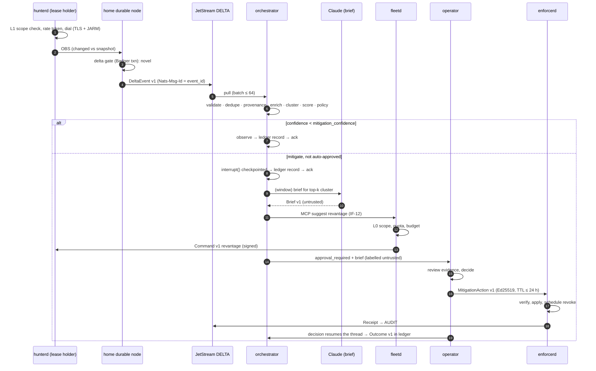
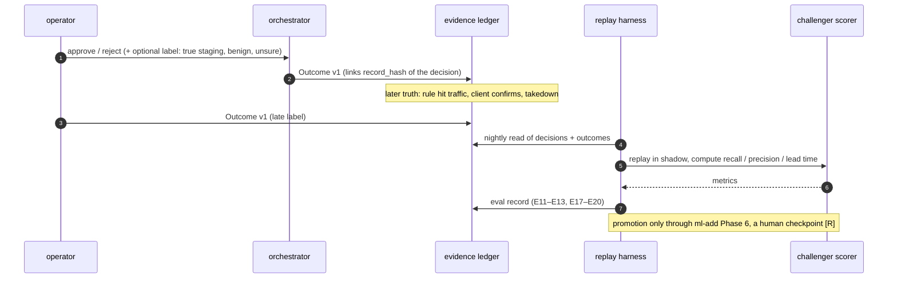

# Hunter Fleet: interfaces, capacity and what the agent system does with the data

**Status:** proposed (design only) · **Date:** 2026-11-20 · **Repo baseline:** `sensai-0x0/cyber-oss` @ `cea8932` (develop, after ml-add Phase 4)
**Companion to:** [hunter-fleet-design.md](hunter-fleet-design.md), which covers images, sharding, leases, rate grants, scope and hardening. This document picks up at the wire: every interface, how much it carries, and what happens to each message after it arrives.

Tags as before: **[M]** measured in this session, **[R]** read from the repo, **[U]** unverified, with a check in §9.

**Decided (Sunyata, 2026-11-20; ADR 0007):** the agent talks to **fleetd over MCP** (streamable HTTP on 6PN), and fleetd commands hunters with **Ed25519-signed, scoped, expiring envelopes over NATS**. stdio MCP is used only for local single-hunter development and the lab. The envelope is signed independently of the transport, so the transport stays swappable (§3.4). Implementation plan: [plans/fleet/README.md](README.md).

---

## 0. Summary

1. **Eighteen interfaces, four planes.** Collection (CT and probes), fleet control (leases, grants, commands), analysis (delta stream → triage → graph → optional LLM brief) and action (approval → signature → enforcement). Each one has a versioned schema, a single writer, an authentication rule, stated delivery semantics and a capacity figure (§2).
2. **The funnel is steep.** In the worked example (§4), 400 connection attempts per second become about **0.4 delta events per second** after the delta gate, about **24 per minute** into triage, at most **10 clusters per 5-minute window** for an LLM brief, and a handful of approval requests per hour for a human. The LLM costs about **$1 an hour** at that rate on Sonnet 5.5.
3. **The agent system today is deterministic.** `orchestrator/graph.py` runs cluster → score → policy → interrupt → ledger, with no LLM call [R]. Tier routing is code (`policy.py`), not a model. This spec keeps it that way and adds the LLM only as an **analyst brief** for the top-k clusters: its output is shown to the operator labelled as untrusted and written to the ledger, and it can *suggest* bounded probes that fleetd scope-checks and budgets. It can never set breadth, kind, TTL, scope, confidence or approval (ml-add rule [R]).
4. **Backpressure runs all the way back to the probes.** If the analysis plane falls behind, the stream fills, durable nodes buffer in Badger, and fleetd lowers rate grants. Overload slows hunting. It never drops evidence silently and never auto-approves (§6).
5. **The people are the real capacity limit.** One orchestrator process handles **85 to 200 events/s** [M], hundreds of times the steady load. Operator review is about 30 to 60 decisions an hour. The design therefore spends its effort on coalescing approvals per campaign and expiring stale ones, not on scaling Python.
6. **One defect would multiply all of this by about fifty.** `newObservation` hashes `observed_at` into the fingerprint (SHR-016 [R]). If that fingerprint feeds the delta gate, every live host looks "mutated" on every pass, and the steady 0.4 events/s becomes about 20/s. The content hash for the gate and for dedupe must exclude time (§5.1, step 3).

---

## 1. Planes and data flow

```mermaid
flowchart LR
  subgraph COLLECT["Collection plane"]
    CTL["CT logs"] -->|IF-01| CTW["CT ingest Worker"]
    W["hunterd workers"] -->|IF-07 OBS| HOME["durable home node<br/>delta gate"]
  end
  subgraph CONTROL["Fleet control plane"]
    OPK["operator: scope key"] -->|IF-03 bundle / halt| FD["fleetd"]
    CTW -->|IF-02 candidates| FD
    FD -->|IF-04 signed commands| W
    W -->|IF-05 register / heartbeat| FD
    FD -->|IF-06 probe requests| W
  end
  subgraph ANALYSE["Analysis plane (orchestrator)"]
    HOME -->|IF-08 DeltaEvent v1| DS[("DELTA stream")]
    DS -->|IF-09 pull consumer| ING["ingest + dedupe"]
    ING --> TRI["triage graph<br/>cluster · score · policy"]
    TRI -->|IF-10 window top-k| BR["analyst brief (LLM)"]
    BR -->|IF-11 Messages API| LLM["Claude"]
    BR -->|IF-12 suggested probes (MCP on fleetd)| FD
    TRI -->|IF-16 append| LED[("evidence ledger")]
  end
  subgraph ACT["Action plane"]
    TRI -->|IF-13 approval_required| OPQ["operator review"]
    OPQ -->|IF-14 MitigationAction v1, Ed25519| ENF["enforcerd"]
    ENF -->|IF-15 receipts| AUD[("AUDIT")]
    OPQ -->|IF-17 outcome labels| LED
  end
  ALL["every service"] -.->|IF-18 health / metrics| OBS["metrics"]
```

Trust boundaries, from the outside in: CT logs and target responses are **hostile input**. Workers are trusted to probe only inside the signed scope, and nothing else. fleetd is trusted for liveness, not for scope. The orchestrator is trusted to *propose*. Only an operator key can *approve*, and only enforcerd can *act* [R, ADR 0001].

---

## 2. Interface catalogue

IDs are `IF-nn`, so they don't collide with the invariants I1 to I20. "Design rate" is what the worked example (§4) produces for a medium engagement. "Ceiling" is the bound the interface enforces; above it, the stated backpressure applies.

### 2.1 Summary table

| ID | From → To | Transport | Schema | Auth | Delivery | Design rate | Ceiling / backpressure |
|---|---|---|---|---|---|---|---|
| IF-01 | CT logs → CT Worker | HTTPS pull (RFC 6962 `get-entries`, or static-CT tiles) | CT log formats | TLS; log signature (STH) verified | Pull with cursor in a Durable Object | thousands of entries/s globally [U] | Worker pulls at its own pace; cursor advances only after IF-02 accepts |
| IF-02 | CT Worker → fleetd | HTTPS POST, mTLS (only public port) | `CandidateHost v1` batch | mTLS client cert pinned to the Worker | At least once; `Idempotency-Key` = batch hash | ≈ 0 to 5/min in-scope [U] | ≤ 500 hosts or 256 KB per batch; `429 Retry-After` on overload |
| IF-03 | Operator → fleetd | CLI over HTTPS mTLS | `ScopeBundle v1`, `Halt v1` | Ed25519 offline scope key (verified by every worker) | Request/response; stored in KV | rare | n/a |
| IF-04 | fleetd → workers | NATS core request/reply on `fleet.ctl.<worker>` | `Command v1` envelope (§3.1) | Subject ACL (fleetd only) **and** Ed25519 fleetd command key | At most once per send; idempotent by `cmd_id`; fleetd retries until acked | ≈ 0.2/s per worker | ≤ 64 KB; unacked command lapses with its lease or grant |
| IF-05 | workers → fleetd | NATS `fleet.reg`, `fleet.hb.<worker>` | `Heartbeat v1` | Per-worker NATS JWT; subject ACL | Fire and forget, every 5 s | 0.2/s per worker | Missed heartbeats = lease expiry (design doc §7) |
| IF-06 | fleetd → lease holder | JetStream `PROBE_REQ` (work queue), subject `hunt.probe.<shard>` | `ProbeRequest v1` | Publish ACL fleetd only; payload signed as IF-04 | At least once; ack after the probe is done; dedupe by `request_id` (2 min window) | CT + re-probe, ≈ 1/min | `max_msgs` 10 000, `discard=new`, alert at 50 % |
| IF-07 | workers → home durable node | JetStream `OBS.<home>` (limits retention) | `Observation v1` (compact) | Per-worker JWT; publish ACL | At least once; idempotent at the delta gate | ≈ 20/s (only changed + seen-bitmaps from burst workers) | 24 h or 1 GiB per home, `discard=new`; publisher buffers then fleetd lowers grants |
| IF-08 | durable → `DELTA` | JetStream `hunt.delta.v1` | **`DeltaEvent v1`** (exists [R]) | Durable-node JWT; publish ACL; event signature proposed (§3.3) | At least once; `Nats-Msg-Id` = `event_id`, 2 min dedupe window | ≈ 0.4/s steady, ≈ 20/s on a baseline pass | 7 d, 10 GiB, `discard=new` → publish error → Badger outbox → grants lowered |
| IF-09 | `DELTA` → orchestrator | JetStream durable pull consumer | `DeltaEvent v1` | Orchestrator JWT, read-only | At least once; explicit ack; `ack_wait` 30 s; `max_deliver` 5 then dead-letter | as IF-08 | `max_ack_pending` 256 is the in-flight cap; above it, delivery stops |
| IF-10 | triage → brief selector | in process | `ClusterSummary v1` | n/a | Every 5 min window | ≤ 10 clusters/window | `top_k` policy key; overflow recorded, not briefed |
| IF-11 | orchestrator → Claude | HTTPS, Messages API (`anthropic` SDK) | `Brief v1` via structured output | API key from env only [R, graph-store Claude-api.md] | SDK retries (2) then drop and count | ≤ 120 calls/h | Hourly and daily token budgets; 429 → skip brief |
| IF-12 | orchestrator → fleetd | **MCP over streamable HTTP on 6PN** (stdio in the lab; ADR 0007) | MCP tools mapped 1:1 to `Command v1` intents | mTLS + orchestrator identity | Request/response; fleetd validates, scope-checks and budgets | ≤ 30 suggestions/h | `suggest_quota_per_hour`; out-of-scope → `ERR_OUT_OF_SCOPE`, no work created |
| IF-13 | graph interrupt → operator | LangGraph `interrupt()` payload, surfaced through the CLI or a review queue (JetStream KV `approvals`) | `ApprovalRequest v1` (existing payload [R] + brief) | Read: operator only | Durable checkpoint resumes the same thread | ≤ 10/h typical | ≤ 50 pending; coalesce per campaign; expire after `proposal_ttl` |
| IF-14 | operator → enforcerd | Today: Go call / CLI [R]. Proposed: NATS `enforce.v1`, publish ACL operator only | **`MitigationAction v1`** (exists, Ed25519 [R]) | Operator signing key; enforcerd verifies (SHR-009 open) | Exactly-once effect by `action_id` (`ErrDuplicateAction` [R]) | ≤ 10/h | TTL ≤ 24 h [R] |
| IF-15 | enforcerd → AUDIT | JetStream `AUDIT` | `Receipt v1` | enforcerd JWT | At least once, hash chained | ≤ 20/h | 90 d retention |
| IF-16 | graph → evidence ledger | SQLite append (WAL) | Ledger record [R] | Local file, Python-owned (ADR 0004 [R]) | Append; a failed write never changes a decision [R] | as IF-09 | Single writer; ≈ 300 appends/s headroom [M, derived] |
| IF-17 | operator outcome → ledger | Ledger append (outcome record) | `Outcome v1` (CBL plan) | Operator identity | Append | as IF-13 | n/a |
| IF-18 | all → metrics | Prometheus scrape, gRPC health [R] | OpenMetrics | 6PN only | Pull | n/a | n/a |

### 2.2 What each interface must refuse

| ID | Refuse and count when | Where |
|---|---|---|
| IF-02 | A host resolves to any IP outside scope (I2), the batch exceeds its limits, or the client cert is unknown | fleetd (L0), then again in workers (L1) |
| IF-04/06 | Bad signature, `cmd_id` already seen, `issued_at` older than 30 s, lease epoch stale, or target outside the bundle | worker |
| IF-07/08 | Payload over 16 KB, an unknown `schema_version`, or a publisher that is not the shard's lease holder or home node | home node / orchestrator |
| IF-09 | Pydantic validation fails (`extra="forbid"` [R]) | orchestrator → dead letter `DELTA.dlq` |
| IF-11 | `stop_reason` is `refusal` or `max_tokens`: never parse; record and drop [R, Claude-api.md GF-C.3] | brief adapter |
| IF-12 | Suggestion outside scope, over quota, or not one of the allowed intents | fleetd |
| IF-14 | Unsigned, expired (SHR-002 open), or `broad` not re-derived in Go (SHR-001 open) | enforcerd |

---

## 3. Schemas

Only `DeltaEvent v1` and `MitigationAction v1` exist today [R]. Every other schema below is **proposed** and goes into `schemas/` through the contract-steward skill before code.

### 3.1 `Command v1` (IF-04, IF-06), transport-neutral

```json
{
  "schema_version": "v1",
  "cmd_id": "cmd_01JD…",
  "issued_at": "2026-11-20T21:40:00Z",
  "issuer": "fleetd/leader/term-7",
  "to": "worker/sin-burst-3f2a",
  "intent": "probe_request",
  "lease": {"shard": "eng-114/s7", "epoch": 42},
  "body": {"request_id": "pr_…", "target": "203.0.113.44", "ports": [443], "kinds": ["tls", "http"], "reason": "ct_candidate", "vantage": null},
  "bundle_sha256": "…",
  "signature": "ed25519:…"
}
```

`intent` is one of `lease_grant`, `rate_grant`, `drain`, `pause`, `resume`, `probe_request`, `revantage`, `release`. A worker checks, in order: signature (fleetd command key, embedded in the image next to the scope key), freshness (30 s), `bundle_sha256` equals its verified bundle, lease epoch, then scope (L1) for any target.

### 3.2 `CandidateHost v1` (IF-02)

```json
{"schema_version": "v1", "source": "ct", "log_id": "…", "leaf_index": 12345678,
 "cert_sha256": "…", "names": ["login.example-client.com"], "not_before": "…",
 "matched_rule": "suffix:example-client.com", "seen_at": "…"}
```

The Worker matches names against the client's **domain watchlist** (part of the scope bundle), never against IPs, because CT carries names. fleetd resolves each name through the pinned resolver and **every** resolved address must be in scope (I2) before an IF-06 request exists.

### 3.3 `DeltaEvent v1` (IF-08, IF-09): additive attributes only

The schema is unchanged [R]. Additive attributes, which v1 consumers tolerate [R, STATE.md]:

| Attribute | Set by | Class | Use |
|---|---|---|---|
| `shard`, `vantage` | home node | OBSERVED (new keys in `OBSERVED_KEYS`) | Routing, divergence |
| `vantage_divergence` | home node, after re-probe | DERIVED | Cloaking evidence |
| `rebaseline` | home node | control | Hold from triage (§6) |
| `content_sha256` | home node | control | Dedupe key that excludes time (fixes the SHR-016 effect) |
| `producer_sig` | home node, Ed25519 over the canonical event | control | **Closes SHR-008** once verified in ingest (proposed; needs ADR) |

### 3.4 Swapping the command transport

| Part | NATS (current proposal) | MCP-over-HTTP to workers (alternative) |
|---|---|---|
| Payload | `Command v1` | same `Command v1`, as the tool argument |
| Authenticity | Ed25519 in the envelope | same |
| Who listens | workers subscribe; no inbound port | each worker opens an HTTPS listener (breaks "no inbound services", needs per-worker certs) |
| Code to change | `internal/ctlbus/nats.go` (planned) | add `internal/ctlbus/mcp.go`; envelope verification untouched |

Because authenticity sits in the envelope, the transport is a plug. The agent-facing MCP on fleetd (IF-12) exists in either case.

---

## 4. Worked sizing example

Medium engagement from the design doc: a /16 (65,536 addresses), 3 ports, `global_cps = 400`. Assumptions are tagged; change any and the arithmetic follows.

### 4.1 Collection to the stream

| Stage | Formula | Value | Basis |
|---|---|---|---|
| Connection attempts | `global_cps` | 400/s | signed budget |
| Probes | attempts ÷ mean token cost 2 | **200 probes/s** | design doc §8.1 [U] |
| Full pass | 65,536 × 3 ÷ 200 | **≈ 16.4 min** | arithmetic |
| Live services | responsive fraction f = 10 % | **≈ 20 observations/s**, 19,660 per pass | [U] typical for a client range |
| Workers needed | 400 ÷ 150 cps per shared-cpu-1x | 3 | [U] until B1 |
| **Baseline pass** (first, or after a store loss) | every observation is new | ≈ 20 events/s for 16 min | held by `rebaseline` (§6) |
| **Steady pass**, change rate c = 2 % of live services per pass | 19,660 × 0.02 ÷ 983 s | **≈ 0.40 events/s ≈ 24/min ≈ 1,440/h** | [U] c depends on the client |
| Same, with SHR-016 feeding the gate | every live service looks mutated | **≈ 20 events/s**, about 50 times more | [R] defect, fixed in §5.1 step 3 |
| CT-derived probes | in-scope new names | ≈ 0 to 300/day | [U] depends on the client's issuance |

Wire volume: a `DeltaEvent` is about **400 bytes** (median 402 B, max 454 B on the repo's 100 fixtures [M]). Real events with SANs and titles will be larger; plan for 2 KB. Steady `DELTA` traffic is then about 800 bytes per second, about 70 MB a day. The 10 GiB stream limit holds months.

### 4.2 Analysis

| Stage | Value | Basis |
|---|---|---|
| Orchestrator throughput, one process, in-memory checkpointer, no ledger | **203 events/s** (4.9 ms/event) | [M] 1,000 fixture events |
| + ledger + campaign shadow scorer | **124 events/s** (8.1 ms) | [M] |
| + SQLite checkpointer (restart-safe interrupts) | **85 events/s** (11.7 ms) | [M] |
| Steady load vs one process | 0.4 ÷ 85 ≈ **0.5 % utilisation** | arithmetic |
| Baseline pass vs one process | 20 ÷ 85 ≈ 24 % (if not held) | arithmetic |
| Clusters per 5-min window | ≈ 120 events → ≈ 40 to 80 clusters [U] | per-target clustering today [R] |
| **Top-k to the brief** | `top_k = 10` per 5-min window → **≤ 120 briefs/h** | policy key (proposed) |
| Mitigate proposals | depends on the scorer; on the fixtures, 0 of 1,000 interrupted [M], because no fixture value is on the pinned lab badlist | [M] |
| Operator review capacity | ≈ 30 to 60 decisions/h per person | [U] planning figure |

The benchmark ran each event as its own graph thread, as the code does today. Interrupts were zero, so it measures the observe path, which is the common one.

### 4.3 LLM token and cost budget

Prices are Anthropic first-party rates as cached on 2026-11-03 [U: re-check before committing a budget]: Opus 5.5 $4 / $20 per MTok (cache reads $0.20), Sonnet 5.5 $2 / $10 (cache reads $0.10), Haiku 5.5 $0.10 / $0.50 (up to 100K prompt). Message Batches are half price. Thinking tokens are billed as output.

Per brief call (one cluster):

| Part | Tokens | Sonnet 5.5 | Opus 5.5 |
|---|---|---|---|
| Cached prefix: instructions, output schema, ontology | 3,000 (cache read) | $0.0003 | $0.0006 |
| Cluster evidence (sanitised, allowlisted fields only) | 1,500 | $0.0030 | $0.0060 |
| Output: brief ≈ 600 + thinking ≈ 1,500 at `effort: low` | 2,100 | $0.0210 | $0.0420 |
| **Per call** | 6,600 | **≈ $0.024** | **≈ $0.049** |

| Route | Model | Calls | Cost |
|---|---|---|---|
| Top-k briefs | Sonnet 5.5, `effort: low` | ≤ 120/h | **≤ $2.9/h**; ≈ $1/h at a typical 40/h |
| Broad-action briefs (attached to a Tier 3 approval) | Opus 5.5, `effort: medium` | ≤ 5/h | ≤ $0.25/h (more thinking; budget $0.05 to $0.10 each) |
| Nightly replay of the day's ledger (shadow analysis) | Sonnet 5.5 via Batches | ≈ 1,000/night | ≈ $12/night |
| **Daily budget cap** (policy key `llm_daily_usd`) | | | **$50/day default**; the adapter stops briefing at the cap and records `brief_skipped:budget` |

Haiku 5.5 is cheap enough to brief every event, but its refusals have no server-side fallback [skill notes] and its benefit over deterministic triage is unproven. Use it only if an eval shows it helps. Security content may trip safety classifiers (`cyber` is a refusal category on Sonnet 5.5 and Opus 5.5): handle `refusal` as "no brief", enable server-side fallbacks on Sonnet and Opus calls, and never retry a refusal with a looser prompt [R, Claude-api.md].

---

## 5. What the agent system does on receipt

### 5.1 Per-event pipeline (every `DeltaEvent`)

"Exists" means the step is in `orchestrator/` at `cea8932`. "Proposed" means it's in this spec.

| # | Step | What happens | State | Writes |
|---|---|---|---|---|
| 1 | **Pull** | Fetch up to 64 messages from the `DELTA` consumer; in-flight stays at or below `max_ack_pending` 256 | proposed (no NATS client yet [R]) | n/a |
| 2 | **Validate** | `DeltaEvent.model_validate`, `extra="forbid"` | exists [R] | invalid → `DELTA.dlq`, `ingest_invalid_total` |
| 3 | **Dedupe** | (a) redelivery: graph `thread_id = event_id`, so a redelivered message resumes the same checkpoint instead of running twice. (b) content: key `content_sha256` = SHA-256 of target + sorted OBSERVED attributes, **excluding time**; seen within 24 h → ack and count. (c) campaign scorer is already idempotent on `event_id` [R] | (c) exists; (a), (b) proposed | dedupe table (bounded, 24 h) |
| 4 | **Producer check** | Verify `producer_sig` against the home node's key, if present; in strict mode require it | proposed (closes SHR-008) | `ingest_unsigned_total` |
| 5 | **Storm guard** | `rebaseline=true`, or the source's rate is 10 times its 1 h median → park in `held` and count. Released after a full pass or by the operator | proposed | `held` table |
| 6 | **Provenance** | Classify every attribute OBSERVED, DERIVED or ASSERTED; asserted scoring keys add nothing | exists [R] | goes into the ledger record |
| 7 | **Enrich** (deterministic, offline) | ASN from an offline database; CDN flag (cdncheck data, pinned); badlist hit (DERIVED, pinned by SHA-256 [R]) | badlist exists; ASN and CDN proposed (ASN source is an open question [R]) | n/a |
| 8 | **Cluster** | `cluster_id` from target + indicators | exists, per-target [R]; campaign identity by indicators runs in shadow [R] | n/a |
| 9 | **Score** | Champion `heuristic.badlist.v1` sets `confidence`; challenger `campaign.belief.v1` scores in shadow only | exists [R] | n/a |
| 10 | **Refine** | Up to `max_refinement_cycles` re-clusters while ambiguous | exists, **decided for removal** (SHR-014, ADR 0004 addendum [R]) | n/a |
| 11 | **Policy** | Below `mitigation_confidence` → `observe`. Otherwise `classify_target` derives kind and breadth from the target alone; `approved` only if narrow **and** `auto_approve_narrow` (false by default) | exists [R] | `policy` in state |
| 12 | **Interrupt** | Any unapproved `mitigate` pauses on `interrupt()` with `approval_required` | exists [R]; needs a durable checkpointer in production [R] | checkpoint |
| 13 | **Ledger** | One hash-chained record: event, evidence classes, intel, policy, policy hash, challenger outputs | exists [R] | `records` |
| 14 | **Ack** | Ack the `DELTA` message only after step 13 (or step 12's checkpoint) commits | proposed | n/a |
| 15 | **Window** | Add the cluster to the current 5-min window for the brief selector | proposed | in memory, rebuilt from the ledger |

Ordering rule: an event is acked only once its outcome is durable, so a crash replays it, and steps 3 and 9 make the replay harmless.

### 5.2 Per-window brief (every 5 minutes, top-k clusters)

1. **Rank** the window's clusters by `(policy.action == mitigate, champion confidence, campaign posterior (shadow, ranking only), novelty, number of events)`. Take `top_k` (default 10). The rest are recorded as `not_briefed:rank`.
2. **Build the input** from an allowlist of fields only: indicators, SANs, ASN, CDN flag, status, title (truncated to 120 chars and escaped), first and last seen, evidence classes, the deterministic policy outcome. **No raw bodies, no free text beyond the allowlist.** Target text is wrapped as data, never placed in instructions.
3. **Call** the Messages API (IF-11) with structured output `Brief v1`:
   ```json
   {"summary": "…", "hypotheses": [{"label": "phishing_staging", "why": "…"}],
    "suggested_actions": [{"intent": "revantage", "target": "203.0.113.44", "why": "…"}],
    "caveats": ["…"]}
   ```
   `suggested_actions.intent` is limited to `request_probe`, `revantage` and `watch`. No mitigation intent exists in the schema.
4. **Check** `stop_reason`. `refusal` or `max_tokens` → `brief_skipped`, no parse.
5. **Use the output in three places only:** (a) attached to any pending approval for that cluster, labelled "model text, untrusted"; (b) the ledger, as a `brief` record; (c) suggestions sent to fleetd over IF-12, where each one is scope-checked (L0, then L1 in the worker), charged to the rate budget and capped by `suggest_quota_per_hour`. A suggested probe returns as an ordinary `DeltaEvent` and goes through §5.1 like any other.
6. **Never** feed brief text into `confidence`, `broad`, `kind`, `ttl_seconds`, scope or approval. A test asserts this, as for challengers today [R].

### 5.3 By event type

| Event | Extra handling beyond §5.1 |
|---|---|
| `novel` · `tlsx` | Usual path. A new host with a fresh certificate and a badlisted JARM is the classic staging signal. Eligible for `revantage` |
| `mutated` · `tlsx` (certificate or JARM changed) | The previous observation hash is in the home node's Badger, not in the event; include `prev_content_sha256` so triage can see what changed without reading Badger (I17) |
| `novel` / `mutated` · `httpx` | Favicon hash (DERIVED badlist check), status, title. Titles are attacker-controlled text: truncated, escaped and never shown unlabelled |
| `ct` (an in-scope name with a new certificate) | Not a probe result. Triage records it, and fleetd has already queued a probe (IF-06) whose result arrives as a `tlsx`/`httpx` event. The two are joined by `cert_sha256` |
| Re-probe result with `vantage_divergence` | Raises rank in the next window; evidence class DERIVED. It does not change `confidence` until a scorer that uses it is promoted through Phase 6 [R] |
| `rebaseline=true` | Parked (step 5). Released in bulk after a full pass, as `observe` records only |
| Operator decision | Approve → operator signs (Go) → enforcerd (IF-14). Reject → recorded as a review result, never signed [R]. Both → `Outcome v1` in the ledger (IF-17) |
| Halt or pause (IF-03/04) | The orchestrator keeps processing what is already in `DELTA` (evidence is still evidence) but fleetd rejects every IF-12 suggestion while paused |

### 5.4 Sequence: a new staging host, end to end



### 5.5 Sequence: label feedback



Labels are scarce, so every approval screen asks for one tap (true / benign / unsure). A rejection is a label too.

---

## 6. Overload behaviour

| Level | Trigger | What the system does | What it never does |
|---|---|---|---|
| **0 Normal** | lag < 1 min | All steps; top-k briefs | n/a |
| **1 Busy** | `DELTA` pending > 1,000 or lag > 5 min | Run 2 to 4 ingest processes, partitioned by `hash(target) mod P` (the ledger stays one writer behind a queue; it has about 300 appends/s headroom [M, derived]). Brief `top_k` drops to 3 | Skip validation, dedupe or provenance |
| **2 Shedding** | lag > 15 min or LLM budget at 80 % | Stop briefs entirely (`brief_skipped:load`). Coalesce approvals: one pending request per campaign, with an event count | Auto-approve anything |
| **3 Backpressure** | `max_ack_pending` reached and `DELTA` at 80 % of its limit | `DELTA` uses `discard=new`, so durable nodes get publish errors and keep events in their Badger outbox. fleetd sees `obs_publish_lag` and **halves grants** (then halves again every minute while lagging). Hunting slows to match analysis | Drop events silently |
| **4 Protect** | `DELTA` full for 10 min, or the operator pauses | fleetd sets `ctl.state = paused`. Evidence stays buffered at the edge. The orchestrator drains | Restart probing before lag < 1 min |
| **Approval queue** | > 50 pending | Coalesce by campaign; proposals older than `proposal_ttl` (default 1 h) expire as `expired_unreviewed` (a recorded outcome, not a silent drop); pager alert | Raise `auto_approve_narrow` |
| **Baseline storm** | first pass, or a restored-empty store | `rebaseline` parks events, so triage sees only the steady delta rate | Brief or interrupt on parked events |
| **LLM degraded** | 429, 5xx, refusals | SDK retries twice, then skip and record; circuit opens for 5 min after 10 failures | Retry a refusal with a looser prompt |

```mermaid
sequenceDiagram
  autonumber
  participant O as orchestrator
  participant J as DELTA stream
  participant H as durable node
  participant F as fleetd
  participant W as workers
  O--xJ: acks slow (lag rising)
  J->>J: pending reaches max_ack_pending, stream near limit
  H->>J: publish → error (discard=new)
  H->>H: keep events in Badger outbox
  H->>F: heartbeat: obs_publish_lag = 6 min
  F->>W: rate_grant halved (signed)
  W->>W: fewer dials; per-block caps unchanged
  O->>J: catches up, lag < 1 min
  H->>J: drain outbox
  F->>W: grants ramp back (slow start)
```

---

## 7. Policy keys this spec adds (`orchestrator/policy.yaml` and the fleet config)

Values are cited here only as proposed defaults. Once added, other files must cite the key name, never the number [R, ADR 0003 consequence 3].

| Key | Default | Used in |
|---|---|---|
| `top_k` | 10 per window | §5.2 |
| `brief_window_seconds` | 300 | §5.2 |
| `brief_model` / `brief_model_broad` | `claude-sonnet-5-5` / `claude-opus-5-5` | §4.3 |
| `llm_hourly_usd` / `llm_daily_usd` | 5 / 50 | §4.3, §6 |
| `suggest_quota_per_hour` | 30 | IF-12 |
| `proposal_ttl_seconds` | 3600 | §6 |
| `max_pending_approvals` | 50 | §6 |
| `dedupe_window_hours` | 24 | §5.1 step 3 |
| `storm_factor` | 10 | §5.1 step 5 |
| `delta_lag_backpressure_seconds` | 360 | §6 level 3 |

---

## 8. Spec changes and evals

### 8.1 Changes (contract-steward first)

1. New schemas: `command.v1`, `candidate_host.v1`, `heartbeat.v1`, `probe_request.v1`, `observation.v1`, `approval_request.v1`, `brief.v1`, `outcome.v1`.
2. `DeltaEvent v1` additive attributes (§3.3) and their entries in `OBSERVED_KEYS` [R].
3. **Fix SHR-016**: fingerprint and gate hash without `observed_at`. This one has the largest capacity effect in the system.
4. `producer_sig` and ingest verification: needs its own ADR (closes SHR-008).
5. A NATS client for the orchestrator and a durable checkpointer choice (pending human checkpoint P2.2 [R]).
6. The brief node and its "no influence on policy" test.

### 8.2 Evals (continuing the design doc's E21 to E25)

| ID | Name | Pass condition | Gate |
|---|---|---|---|
| E26 | Funnel stability | A replayed steady pass with no content change produces 0 delta events (catches SHR-016-type regressions) | **Hard** |
| E27 | Brief isolation | Over the fixture set, policy output is byte-identical with the brief on, off, or replaced by adversarial text | **Hard** |
| E28 | Backpressure, no loss | With the orchestrator stopped for 30 min, every probe-time event is eventually ledgered exactly once, and fleet cps drops below 50 % within 3 min | Hard |
| E29 | Approval coalescing | 200 events from one campaign produce 1 pending approval with a count | Soft |
| E30 | LLM budget | A synthetic burst never exceeds `llm_hourly_usd` (measured from `usage`) | Hard |

---

## 9. Unverified items

| ID | Item | How to check |
|---|---|---|
| V1 | Responsive fraction f and change rate c per pass | Two lab passes, then the first real engagement's first day |
| V2 | JetStream throughput and storage on the NATS VM sizes chosen | `nats bench` on the Fly cluster (design doc F4) |
| V3 | CT in-scope candidate rate | Replay one week of CT for the client's watchlist |
| V4 | Token counts per brief | `count_tokens` on 50 real clusters before setting `llm_daily_usd` |
| V5 | Claude prices and rate limits for the account | Pricing page and the organisation's rate-limit report; prices quoted are the 2026-11-03 cached list |
| V6 | Refusal rate on security briefs | 100-cluster sample on Sonnet 5.5 with fallbacks enabled |
| V7 | Operator review rate | Time 50 lab approvals |
| V8 | Orchestrator throughput with real event sizes and a Postgres or SQLite checkpointer under concurrency | Repeat Appendix A with 2 KB events and 4 processes |

---

## 10. State record

| Date | Item | State |
|---|---|---|
| 2026-11-20 | This interface and agent-flow spec | **Proposed**, awaiting review |
| 2026-11-20 | Command channel: MCP agent ↔ fleetd; signed NATS fleetd → hunters; stdio MCP for lab only | **Approved by Sunyata**; ADR 0007 |
| 2026-11-20 | Measured: graph throughput 203 / 124 / 85 events/s (three configurations); fixture event ≈ 400 B; 0 of 1,000 fixture events interrupt | Recorded (Appendix A) |
| 2026-11-20 | Found: the LLM is not in the runtime graph today; tier routing is deterministic | Recorded; the brief is additive and isolated |
| 2026-11-20 | Correction to the design doc: the `/32` panic is already tracked as SHR-006 | Recorded |

---

## Appendix A: how the [M] numbers were produced

Repo at `cea8932`, Python 3.12 via `uv sync --frozen`, one process, events from `orchestrator/tests/fixtures/triage/scenarios.jsonl` cycled to 1,000 with unique `event_id`s, one LangGraph thread per event:

```python
g = build_graph(checkpointer=MemorySaver())                                   # 203 events/s
g = build_graph(checkpointer=MemorySaver(), ledger=Ledger(p), challengers=(CampaignScorer(),))   # 124 events/s
g = build_graph(checkpointer=build_sqlite_checkpointer(p2), ledger=Ledger(p3), challengers=(CampaignScorer(),))  # 85 events/s
for i in range(1000): g.invoke({"event": ev_i}, {"configurable": {"thread_id": uuid4()}})
```

Event size: `len(json.dumps(event))` over the 100 fixtures, median 402 B, max 454 B. The "≈ 300 appends/s" ledger headroom is derived from the difference between the first two runs (≈ 3.2 ms for ledger + campaign together), not measured on its own.
